# Elements: Primitives, Composites, and Ideograms

A visual catalogue of every drawable in SeqPlotR: primitives
(`seq_point`, `seq_line`, `seq_segment`, `seq_curve`, `seq_path`,
`seq_poly`, `seq_area`, `seq_text`), composites (`seq_bar`,
`seq_ribbon`, `seq_density`, `seq_tile`, `seq_lollipop`, `seq_gene`,
`seq_sequence`), the ideogram, and the scalebar. Windows, margins and
layouts are covered in
[`vignette("layouts")`](http://andrewlynch.io/SeqPlotR/articles/layouts.md).

``` r

library(SeqPlotR)
#> 
#> Attaching package: 'SeqPlotR'
#> The following object is masked from 'package:base':
#> 
#>     %||%
library(GenomicRanges)
#> Loading required package: stats4
#> Loading required package: BiocGenerics
#> Loading required package: generics
#> 
#> Attaching package: 'generics'
#> The following objects are masked from 'package:base':
#> 
#>     as.difftime, as.factor, as.ordered, intersect, is.element, setdiff,
#>     setequal, union
#> 
#> Attaching package: 'BiocGenerics'
#> The following objects are masked from 'package:stats':
#> 
#>     IQR, mad, sd, var, xtabs
#> The following objects are masked from 'package:base':
#> 
#>     anyDuplicated, aperm, append, as.data.frame, basename, cbind,
#>     colnames, dirname, do.call, duplicated, eval, evalq, Filter, Find,
#>     get, grep, grepl, is.unsorted, lapply, Map, mapply, match, mget,
#>     order, paste, pmax, pmax.int, pmin, pmin.int, Position, rank,
#>     rbind, Reduce, rownames, sapply, saveRDS, table, tapply, unique,
#>     unsplit, which.max, which.min
#> Loading required package: S4Vectors
#> 
#> Attaching package: 'S4Vectors'
#> The following object is masked from 'package:utils':
#> 
#>     findMatches
#> The following objects are masked from 'package:base':
#> 
#>     expand.grid, I, unname
#> Loading required package: IRanges
#> Loading required package: Seqinfo

# single window used for most demos
win <- GRanges("chr1", IRanges(1e6, 3e6))
```

Several examples use simulated tumour data shipped with the package: a
BFB amplicon on chr2 (`bfb`), whole-genome doubling on chr1-3 (`wgd`),
chromothripsis on chr3 (`ct`) and chromothripsis with BFB on chr4
(`ct_bfb`). Each scenario has copy-number segments, SVs and SNVs with a
variant allele fraction (VAF).

``` r

sim <- function(sc, f) {
  utils::read.delim(system.file("extdata", "sim", sc, f, package = "SeqPlotR"))
}
seg_to_gr <- function(d) {
  GRanges(d$chrom, IRanges(d$start, d$end),
          cn = d$cn, cn_major = d$cn_major, cn_minor = d$cn_minor, baf = d$baf)
}
snv_to_gr <- function(d) {
  GRanges(d$chrom, IRanges(d$pos, width = 1),
          vaf = d$vaf, sbs6 = d$sbs6, mult = as.character(d$truth_mult))
}

bfb_snv <- snv_to_gr(sim("bfb", "snvs.tsv"))
bfb_seg <- seg_to_gr(sim("bfb", "segments.tsv"))
bfb_win <- GRanges("chr2", IRanges(1.75e8, 2.05e8))

wgd_snv <- snv_to_gr(sim("wgd", "snvs.tsv"))

ct_seg  <- seg_to_gr(sim("ct", "segments.tsv"))
ct_win  <- GRanges("chr3", IRanges(9.5e7, 1.95e8))

ctb_seg <- seg_to_gr(sim("ct_bfb", "segments.tsv"))
ctb_sv  <- sim("ct_bfb", "svs.tsv")
ctb_sv  <- GRanges(ctb_sv$chrom1, IRanges(ctb_sv$pos1, width = 1),
                   jcn = ctb_sv$jcn, sv_type = ctb_sv$sv_type)
ctb_win <- GRanges("chr4", IRanges(5.8e7, 1.24e8))
```

## Primitives

Every primitive shares the same three-stage contract (`initialize` →
`prep` → `draw`) and the same shorthand:
`seq_<name>(map(...), aesthetics = aes(...))`. What differs is the
[`map()`](http://andrewlynch.io/SeqPlotR/reference/map.md) vocabulary
each one consumes. Per-track `data` + `mapping` are inherited, so a
single
[`seq_track()`](http://andrewlynch.io/SeqPlotR/reference/seq_track.md)
can host several primitives drawing from the same table.

### `seq_point` — one glyph per observation

Required [`map()`](http://andrewlynch.io/SeqPlotR/reference/map.md)
fields: `x`, `y`. Optional: `color`, `fill`, `size`, `shape`, `alpha`.

Below, each SNV from a simulated BFB amplicon on chr2 is a point at its
position, with VAF on `y`, coloured by the true number of mutated copies
(`mult`). SNVs inside the amplified region carry several copies.

``` r

seq_plot(aesthetics = aes(margins = list(top = 0, right = 0.12,
                                         bottom = 0, left = 0))) %|%
  seq_track(data = bfb_snv,
            mapping = map(x = start, y = vaf),
            windows = bfb_win) %+%
  seq_point(map(color = mult),
            aesthetics = aes(size = 0.5, alpha = 0.8)) -> p
p$plot()
```

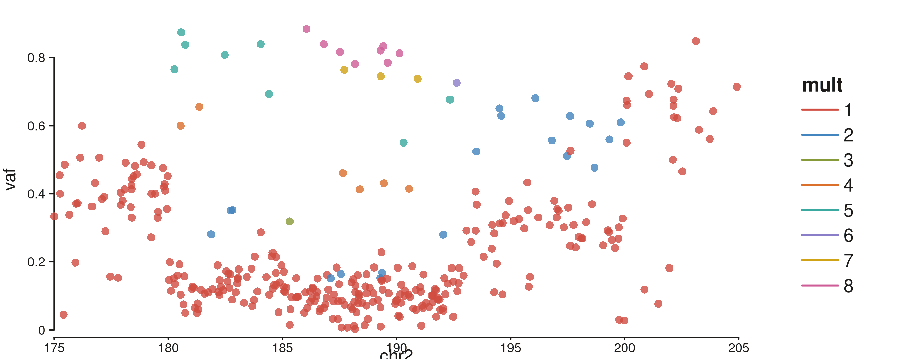

### `seq_line` — connected line through points

Required: `x`, `y`. `aes(type = "step")` switches to a step line (useful
for signal tracks that represent piecewise-constant values).

Below, the simulated BFB amplicon on chr2 is shown as the mean SNV VAF
in 1 Mb bins (smooth) and as the piecewise-constant copy number of each
segment (step). Both rise across the amplified region.

``` r

bfb_win_snv <- subsetByOverlaps(bfb_snv, bfb_win)
bin_start   <- seq(start(bfb_win), end(bfb_win) - 1e6, by = 1e6)
bin_id      <- factor(findInterval(start(bfb_win_snv), bin_start), seq_along(bin_start))
bfb_bins    <- GRanges("chr2", IRanges(bin_start + 5e5, width = 1),
                       mean_vaf = as.vector(tapply(bfb_win_snv$vaf, bin_id, mean)),
                       n_snv    = as.vector(table(bin_id)))
```

``` r

seq_plot() %|%
  seq_track(track_id = "Mean VAF",
            data = bfb_bins,
            mapping = map(x = start, y = mean_vaf),
            windows = bfb_win) %+%
  seq_line(aesthetics = aes(color = "#205EA6", linewidth = 1.4)) %__%
  seq_track(track_id = "Copy number",
            data = bfb_seg,
            mapping = map(x = start, y = cn),
            windows = bfb_win) %+%
  seq_line(aesthetics = aes(color = "#AF3029",
                            linewidth = 1.4,
                            type = "step")) -> p
p$plot()
#> 1 out-of-bounds data points excluded! (seq_line)
```

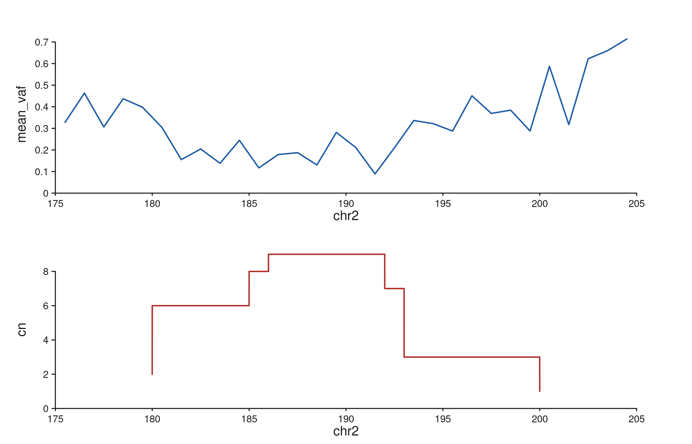

### `seq_segment` — one straight line per row

Required: `x`, `x_end`, `y`, `y_end`. Great for quick interval marks — a
peak span, a read pair, a Manhattan-style baseline. Below, each
copy-number segment of a simulated chromothripsis event on chr3 is a
horizontal line at its total copy number; the oscillation between CN 3
and CN 1 is the chromothripsis signature.

``` r

seq_plot() %|%
  seq_track(data = ct_seg,
            mapping = map(x = start, x_end = end,
                          y = cn, y_end = cn),
            windows = ct_win) %+%
  seq_segment(aesthetics = aes(linewidth = 3, color = "#205EA6")) -> p
p$plot()
```

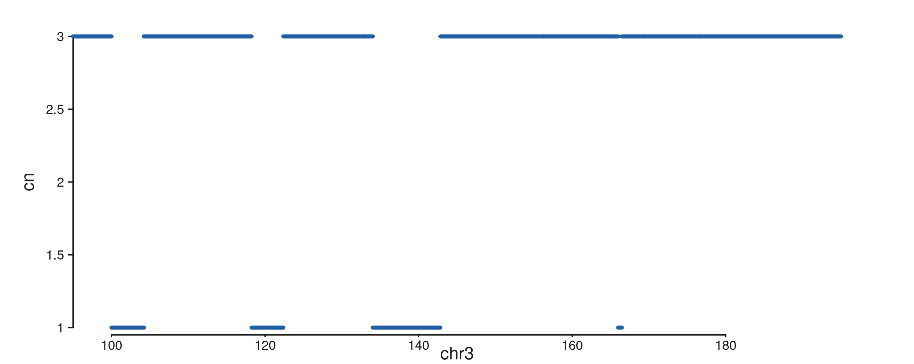

### `seq_curve` — Bezier curve with data-space control points

Required: `x`, `y`, `x_end`, `y_end`. `aes(curvature)` sets the
fractional y-offset of the control points (default `0.3`). Handy for
visualising directional relationships (a transcript splice, a read pair)
without stealing the arch slot (`seq_arc`) used for SV calls.

``` r

curve_gr <- GRanges("chr1",
  IRanges(start = c(1.2e6, 1.7e6, 2.3e6), width = 1),
  x_end = c(1.5e6, 2.1e6, 2.7e6),
  y     = c(0.2,   0.3,   0.25),
  y_end = c(0.5,   0.7,   0.6))

seq_plot() %|%
  seq_track(data = curve_gr,
            mapping = map(x = start, x_end = x_end,
                          y = y, y_end = y_end),
            windows = win) %+%
  seq_curve(aesthetics = aes(curvature = 0.5,
                             color = "#66800B",
                             linewidth = 1.4)) -> p
p$plot()
```

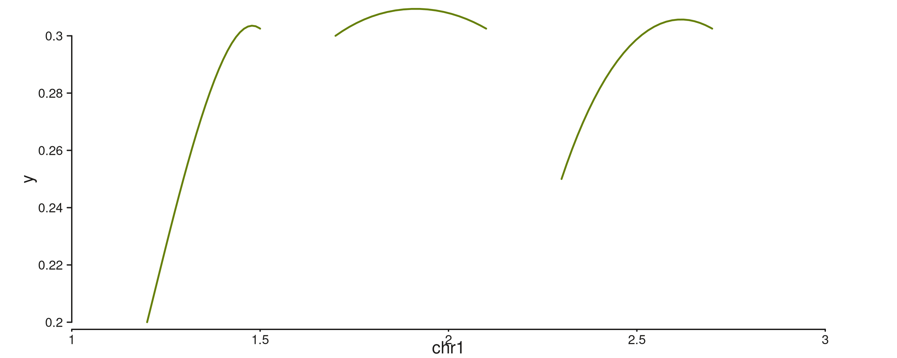

### `seq_path` — poly-line through grouped points

Required: `x`, `y`. Optional `group` splits the path into several
disconnected lines. Good for plotting per-group traces on one track.

``` r

group_xs <- seq(1.05e6, 2.95e6, length.out = 30)
path_gr  <- GRanges("chr1",
  IRanges(start = rep(group_xs, 3), width = 1),
  y     = c(sin((group_xs - 1e6) / 5e5) * 0.2 + 0.4,
            cos((group_xs - 1e6) / 4e5) * 0.2 + 0.5,
                 ((group_xs - 1e6) / 2e6) * 0.3 + 0.3),
  trace = rep(c("A", "B", "C"), each = 30))

seq_plot() %|%
  seq_track(data = path_gr,
            mapping = map(x = start, y = y,
                          group = trace, color = trace),
            windows = win) %+%
  seq_path(aesthetics = aes(linewidth = 1.3, alpha = 0.85)) -> p
p$plot()
```

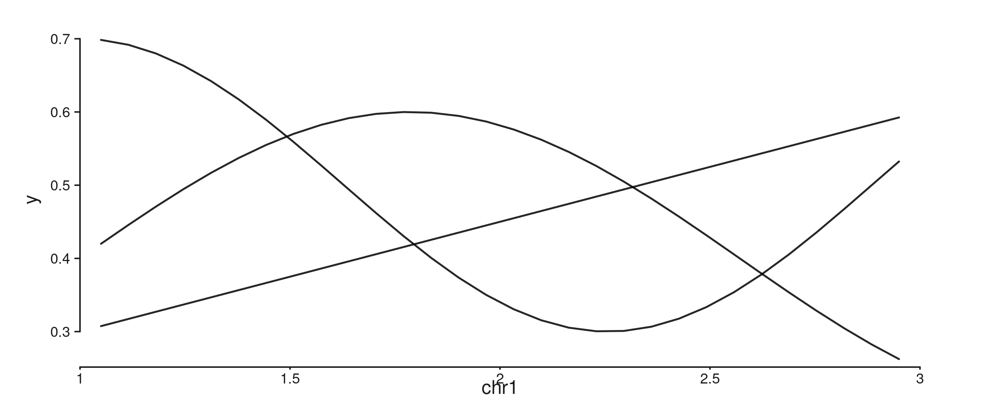

### `seq_poly` — filled polygon(s) from vertices

Required: `x`, `y`. Optional `group` partitions vertices across multiple
polygons. Use for custom region highlights and hand-shaped overlays.
Below: three filled triangles, one per gene body.

``` r

tri_starts <- c(1.20e6, 1.80e6, 2.40e6)
tri_widths <- c(2.5e5,  3.0e5,  2.0e5)

poly_gr <- GRanges("chr1",
  IRanges(start = rep(tri_starts, each = 3), width = 1),
  x_v = c(rbind(tri_starts,
                tri_starts + tri_widths / 2,
                tri_starts + tri_widths)),
  y_v = rep(c(0.2, 0.8, 0.2), times = 3),
  grp = rep(paste0("tri", 1:3), each = 3))

seq_plot() %|%
  seq_track(data = poly_gr,
            mapping = map(x = x_v, y = y_v,
                          group = grp, fill = grp),
            windows = win) %+%
  seq_poly(aesthetics = aes(color = "white", alpha = 0.8)) -> p
p$plot()
```

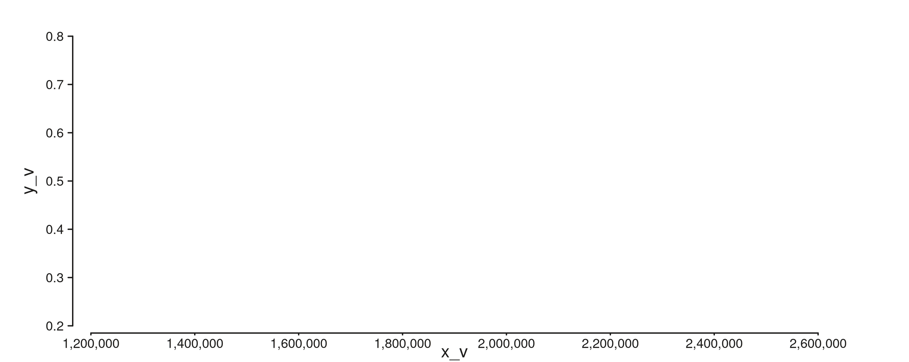

### `seq_area` — filled area under a curve

Required: `x`, `y`. Optional `aes(baseline = ...)` sets the closing
y-value (default `0`). Coverage curves, pileups, smoothed density fills.

Below, the number of SNVs per 1 Mb bin of the simulated BFB amplicon on
chr2; mutation counts climb with copy number.

``` r

seq_plot() %|%
  seq_track(data = bfb_bins,
            mapping = map(x = start, y = n_snv),
            windows = bfb_win) %+%
  seq_area(aesthetics = aes(fill = "#4385BE",
                            color = "#205EA6",
                            alpha = 0.65,
                            linewidth = 0.8)) -> p
p$plot()
```

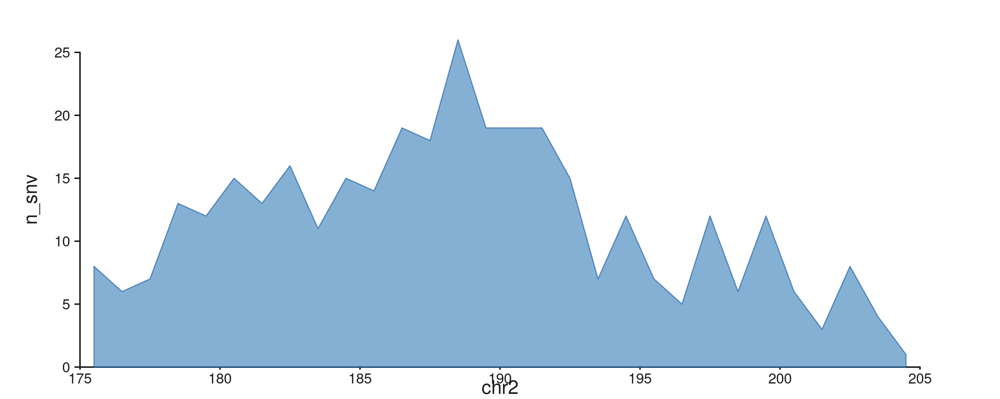

### `seq_text` — per-observation labels

Required: `x`, `y`, `label`. Optional: `size`, `color`, `angle`,
`hjust`, `vjust`.

``` r

text_gr <- GRanges("chr1",
  IRanges(start = c(1.30e6, 1.90e6, 2.50e6), width = 1),
  y_pos = c(0.75, 0.45, 0.85),
  lbl   = c("peak_1", "peak_2", "peak_3"))

seq_plot() %|%
  seq_track(data = text_gr,
            mapping = map(x = start, y = y_pos, label = lbl),
            windows = win) %+%
  seq_text(aesthetics = aes(fontsize = 12,
                            color = "#AF3029",
                            hjust = 0.5)) -> p
p$plot()
```

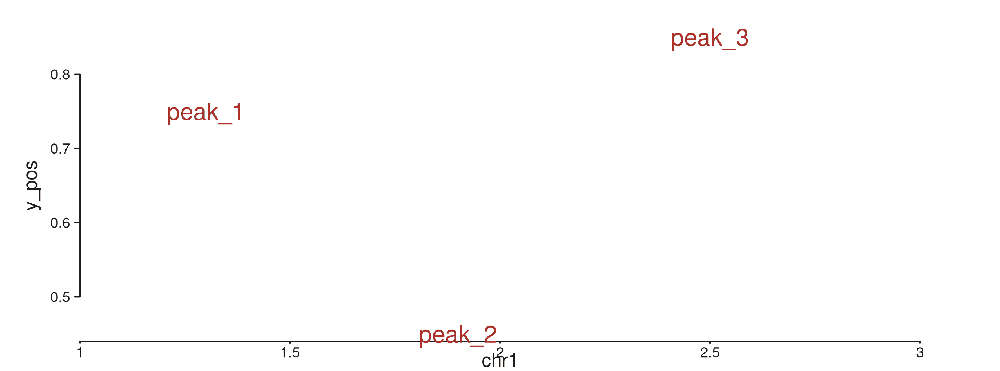

## Composites

Composites chain primitives (often plus a small amount of
pre-computation) to provide higher-level idioms. Each composite inherits
from its underlying primitive and exposes a narrower, task-specific
[`map()`](http://andrewlynch.io/SeqPlotR/reference/map.md) vocabulary.

### `seq_bar` — per-interval rectangles

One rectangle per observation; `group` stacks bars at identical x
positions. Below, each segment of a simulated chromothripsis and BFB
event on chr4 is a bar spanning the segment, with height equal to its
copy number.

``` r

seq_plot() %|%
  seq_track(data = ctb_seg,
            mapping = map(x = start, y = cn),
            windows = ctb_win,
            scale_y = seq_scale_continuous(limits = c(0, 6))) %+%
  seq_bar(aesthetics = aes(fill = "#4385BE")) -> p
p$plot()
```

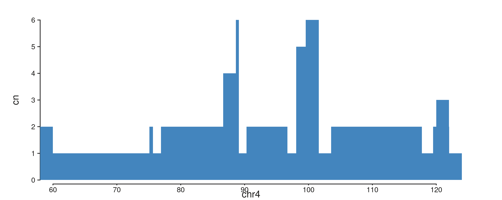

#### Stacked bars

Supplying a `group` mapping causes bars at identical x positions to
stack. Colors are drawn from the Flexoki palette keyed on group level.

``` r

stack_gr <- GRanges(
  "chr1",
  IRanges(start = rep(seq(1.2e6, 2.8e6, by = 2e5), each = 3), width = 5e4),
  value    = runif(27, 0.1, 0.5),
  category = rep(c("A", "B", "C"), times = 9)
)

seq_plot() %|%
  seq_track(data = stack_gr,
            mapping = map(x = start, y = value, group = category),
            windows = win) %+%
  seq_bar() -> p
p$plot()
#> 8 out-of-bounds data points excluded! (seq_bar)
```

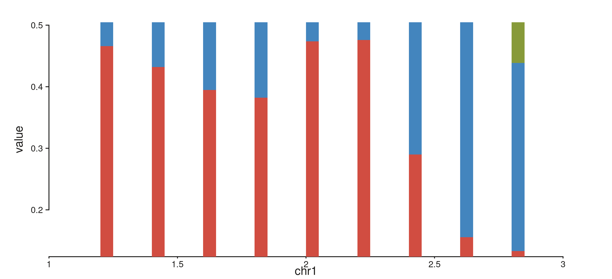

### `seq_ribbon` — band between two y series

Required: `y_min`, `y_max`. Confidence bands, min/max pileups, CI
envelopes — anything that needs a shaded interval per x. Below, the band
between the minor and major allele copy number of the simulated chr4
event; the band collapses to zero width in balanced segments and sits on
the major allele where the minor allele is lost.

``` r

# one point at each segment edge so the band is piecewise constant
ctb_edges <- GRanges("chr4",
  IRanges(c(start(ctb_seg), end(ctb_seg)), width = 1),
  cn_minor = rep(ctb_seg$cn_minor, 2),
  cn_major = rep(ctb_seg$cn_major, 2))
ctb_edges <- sort(ctb_edges)

seq_plot() %|%
  seq_track(data = ctb_edges,
            mapping = map(x = start, y_min = cn_minor, y_max = cn_major),
            windows = ctb_win,
            scale_y = seq_scale_continuous(limits = c(0, 3))) %+%
  seq_ribbon(aesthetics = aes(fill = "#4385BE", alpha = 0.5)) -> p
p$plot()
```

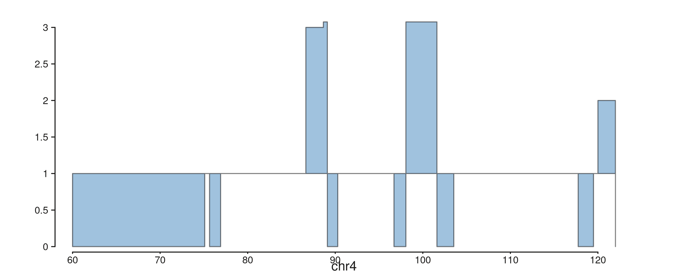

### `seq_density` — kernel density estimate

Calls [`stats::density()`](https://rdrr.io/r/stats/density.html) on the
resolved `y` and renders the result as a filled area. Pre-computed
densities should use
[`seq_area()`](http://andrewlynch.io/SeqPlotR/reference/seq_area.md)
directly. Below, the VAF of SNVs from a simulated whole-genome-doubling
tumour on chr1-3. The density runs along the x-axis (VAF, 0 to 1) and
`bw` sets the bandwidth; the modes come from SNVs carried by one, two or
four copies.

``` r

seq_plot() %|%
  seq_track(data = wgd_snv,
            mapping = map(x = start, y = vaf),
            windows = GRanges("chr1", IRanges(1, 248956422)),
            scale_x = seq_scale_continuous(limits = c(0, 1)),
            scale_y = seq_scale_continuous(limits = c(0, 1)),
            aesthetics = aes("axis.y1.visible" = FALSE,
                                "axis.x1.title.text" = "VAF")) %+%
  seq_density(aesthetics = aes(fill = "#879A39", alpha = 0.7, bw = 0.02)) -> p
p$plot()
```

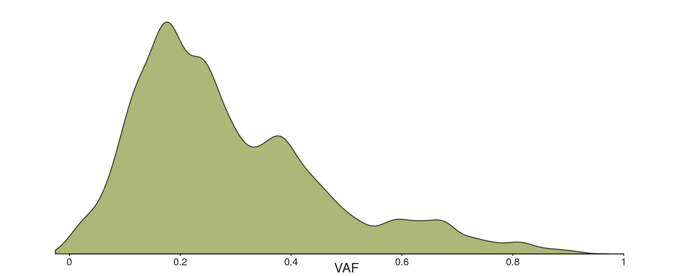

### `seq_tile` — rectangles per interval

Flat mode: one rectangle per observation, here one tile per segment of
the simulated chr4 event, shaded by the B-allele frequency (`baf`; 0.5
is balanced, 1 is LOH). Rotated mode (`aes(rotate = TRUE)`) turns each
tile into a diamond, the standard Hi-C representation when combined with
a genomic y-axis (see below).

``` r

baf_ramp <- grDevices::colorRampPalette(c("#DAD8CE", "#205EA6"))(100)
ctb_seg$baf_col <- baf_ramp[round((ctb_seg$baf - 0.5) / 0.5 * 99) + 1]

seq_plot() %|%
  seq_track(data = ctb_seg,
            mapping = map(x = start, fill = baf_col),
            windows = ctb_win) %+%
  seq_tile() -> p
p$plot()
```

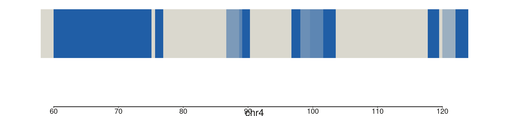

#### Rotated tiles

Rotated tiles (`aes(rotate = TRUE)`) place each observation as a diamond
in `(genomic_x, genomic_y)` space — the natural representation for Hi-C
contacts or any 2D genomic relationship. Both axes are genomic; pass a
[`seq_scale_genomic()`](http://andrewlynch.io/SeqPlotR/reference/seq_scale_genomic.md)
`scale_y` built from the distance-bin `GRanges`.

``` r

n_contacts <- 60
hic_win <- GRanges("chr1", IRanges(1e6, 3e6))

# Toy Hi-C: pick x-bins, then y-bins offset by a genomic distance.
x_starts <- sample(seq(1.05e6, 2.95e6, by = 2e4), n_contacts, replace = TRUE)
y_offset <- sample(seq(2e4, 8e5, by = 2e4), n_contacts, replace = TRUE)

x_gr <- GRanges("chr1", IRanges(start = x_starts,            width = 2e4),
                score = runif(n_contacts))
y_gr <- GRanges("chr1", IRanges(start = x_starts + y_offset, width = 2e4))

# Map [0,1] scores → a soft red ramp for the fill column.
score_to_color <- function(s) {
  pal <- grDevices::colorRampPalette(c("#F4A4C2", "#A02C6D"))(100)
  pal[pmin(pmax(round(s * 99) + 1, 1), 100)]
}
x_gr$fill_col <- score_to_color(x_gr$score)

seq_plot() %|%
  seq_track(data = x_gr,
            mapping = map(x = start, fill = fill_col),
            windows = hic_win,
            scale_y = seq_scale_genomic(
              GRanges("chr1", IRanges(0, max(y_offset) + 2e4)))) %+%
  seq_tile(data2 = y_gr, aesthetics = aes(rotate = TRUE)) -> p
p$plot()
```

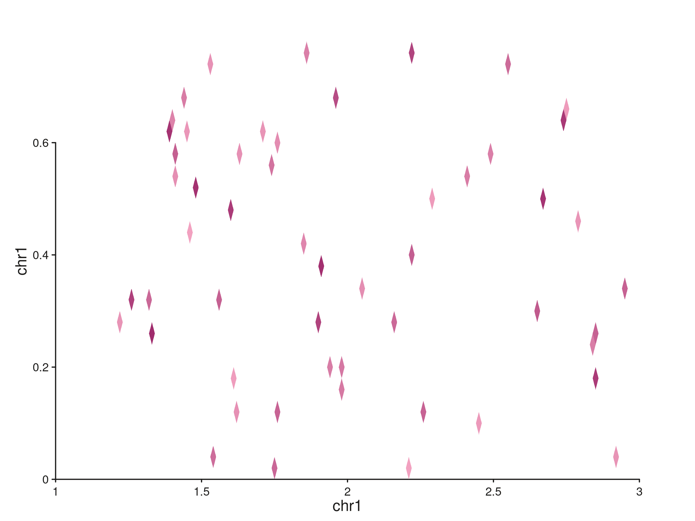

### `seq_lollipop` — stem + point

Vertical stem from `baseline` (default `0`) up to `y`, with a point at
`y`. Standard for sparse discrete events (mutation impact, peak
summits). Below, the junctions of the simulated chr4 event, placed at
their first breakpoint with height equal to the junction copy number
(`jcn`).

``` r

seq_plot() %|%
  seq_track(data = ctb_sv,
            mapping = map(x = start, y = jcn),
            windows = ctb_win,
            scale_y = seq_scale_continuous(limits = c(0, 5.5))) %+%
  seq_lollipop(aesthetics = aes(color = "#AF3029", linewidth = 1.2)) -> p
p$plot()
```

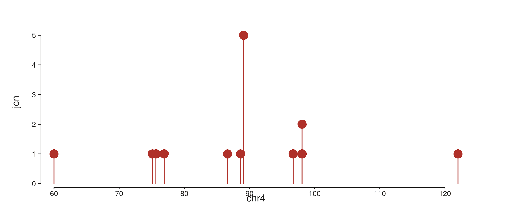

### `seq_gene` — format-agnostic gene models

Every column reference comes through
[`map()`](http://andrewlynch.io/SeqPlotR/reference/map.md): `group`
joins features into one gene, `strand` orients the arrows, `type`
distinguishes exons from UTRs, `label` places the gene name, `color`
tints each gene.

``` r

# reused by the gene examples below
gm <- map(group = gene_id, type = feature, strand = strand_col,
          label = gene_name, color = color)

gene_gr <- GRanges("chr1",
  IRanges(
    start = c(1.10e6, 1.20e6, 1.35e6, 1.50e6, 1.58e6,
              1.90e6, 2.05e6, 2.18e6, 2.30e6,
              2.55e6, 2.68e6, 2.80e6),
    width = c( 3e4,  6e4,  4e4,  5e4,  2e4,
               4e4,  8e4,  5e4,  3e4,
               6e4,  3e4,  5e4)
  ),
  gene_id    = rep(c("A", "B", "C"), times = c(5, 4, 3)),
  gene_name  = rep(c("TP53", "MYC", "BRCA1"), times = c(5, 4, 3)),
  strand_col = rep(c("+", "-", "+"),       times = c(5, 4, 3)),
  feature = c("UTR","exon","exon","exon","UTR",
              "UTR","exon","exon","UTR",
              "exon","exon","exon"),
  color = c(rep("#205EA6", 5),
            rep("#AF3029", 4),
            rep("#66800B", 3)))

seq_plot() %|%
  seq_track(data = gene_gr,
            mapping = gm,
            windows = win) %+%
  seq_gene(gm) -> p
p$plot()
```


#### Backbone styles

`backbone_type` controls the gene backbone rendering. `"arrow"`
(default) places chevron arrows to show strand direction. `"solid"`
draws a plain line; `"dashed"` uses a dashed line — useful for predicted
or low-confidence models.

``` r

seq_plot() %|%
  seq_track(data = gene_gr,
            mapping = gm,
            windows = win) %+%
  seq_gene(gm,
           backbone_type = "dashed") -> p
p$plot()
```

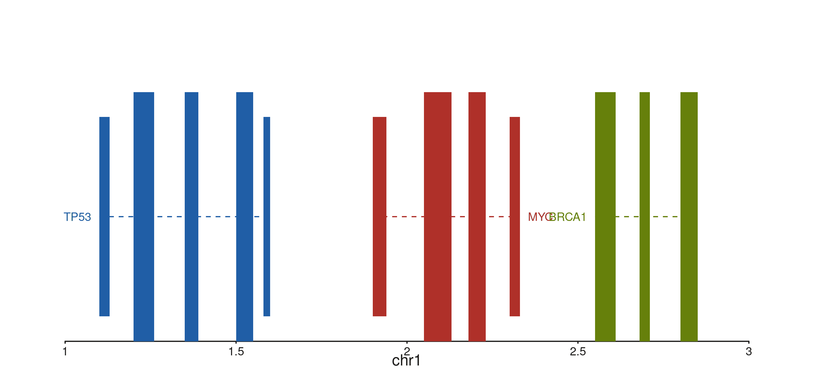

#### TSS start-site arrow

`show_start = TRUE` draws a flag arrow above the first exon (by row
order) of each gene. For genes where the annotated first exon differs
from the true TSS, pass `tss_position = list(gene_id = c(start, end))`
to override the auto-detected position per gene.

``` r

seq_plot() %|%
  seq_track(data = gene_gr,
            mapping = gm,
            windows = win) %+%
  seq_gene(gm,
           show_start = TRUE) -> p
p$plot()
```

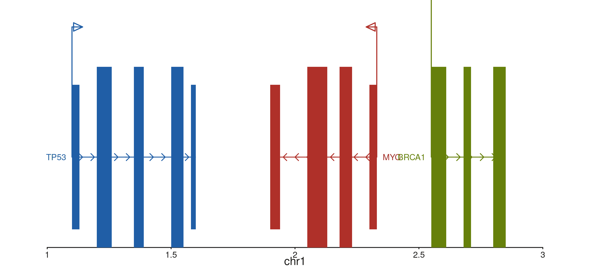

#### Strand separation

`separate_strands = TRUE` partitions the track interior into two
horizontal sub-bands: `"+"` strand genes at the top and `"-"` strand
genes at the bottom. A dashed line marks the band boundary and each band
is labelled. Silently ignored when only one strand is present.

``` r

seq_plot() %|%
  seq_track(data = gene_gr,
            mapping = gm,
            windows = win) %+%
  seq_gene(gm,
           separate_strands = TRUE) -> p
p$plot()
```

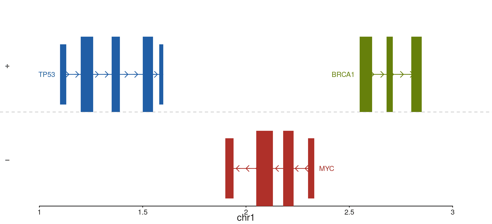

#### All features combined

`separate_strands`, `show_start`, and `backbone_type` are independent
and compose freely. Here both are on with a solid backbone — useful when
the track already conveys directionality through the strand band layout.

``` r

seq_plot() %|%
  seq_track(data = gene_gr,
            mapping = gm,
            windows = win,
            track_height = 1.2) %+%
  seq_gene(gm,
           backbone_type    = "solid",
           show_start       = TRUE,
           separate_strands = TRUE) -> p
p$plot()
```

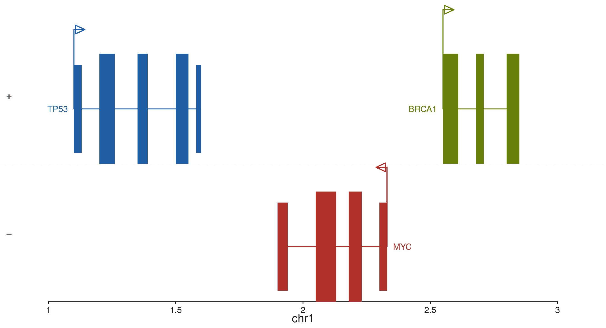

#### Style type

`style_type` selects the per-gene rendering style. `"exon"` (default) is
the full backbone-plus-exon-boxes view shown above; `"gene"` collapses
each gene to a single chevron-shaped polygon spanning the gene extent —
useful when exon detail is not needed and screen space is tight;
`"point"` reduces each gene to a single filled circle at the TSS, ideal
for very dense overviews. Labels are drawn in all three modes.

``` r

seq_plot() %|%
  seq_track(data = gene_gr,
            mapping = gm,
            windows = win) %+%
  seq_gene(gm,
           style_type = "gene") -> p
p$plot()
```

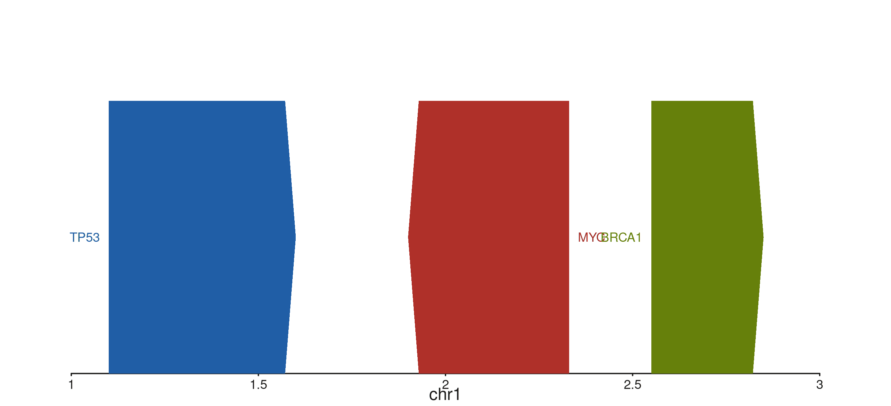

``` r

seq_plot() %|%
  seq_track(data = gene_gr,
            mapping = gm,
            windows = win) %+%
  seq_gene(gm,
           style_type = "point") -> p
p$plot()
```

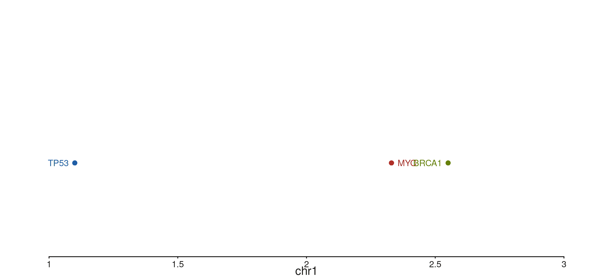

#### Label placement

`aes(gene.label = aes(position = c(<"start"|"end">, <"top"|"bottom">)))`
composes label placement independently on x and y.

``` r

gr_genes <- GRanges("chr1",
  IRanges(start = c(100,  400, 1000, 1500),
          end   = c(300,  600, 1200, 1700)),
  gene_id    = c("geneA", "geneA", "geneB", "geneB"),
  gene_name  = c("GeneA", "GeneA", "GeneB", "GeneB"),
  strand_col = c("+", "+", "-", "-"),
  feat_type  = c("exon", "exon", "exon", "exon")
)

win_g <- GRanges("chr1", IRanges(1, 2000))

p <- seq_plot() %+%
  (seq_track(data = gr_genes, windows = win_g) %+%
   seq_gene(
     map(group = gene_id, label = gene_name,
         strand = strand_col, type = feat_type),
     aesthetics = aes(
       gene.label = aes(position = c("start", "top"),
                        color    = "navy",
                        size     = 0.55)
     )
   ))
p$plot()
```

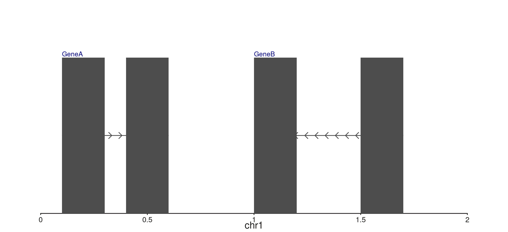

#### Dense dataset — tier stacking

When genes overlap, `seq_gene` stacks them into non-overlapping tiers
automatically. With `separate_strands = TRUE` each strand band has its
own tier stack, keeping the two strands visually separated even at high
gene density.

``` r

set.seed(7)
n_genes  <- 14
starts   <- sort(sample(seq(1.05e6, 2.6e6, by = 5e4), n_genes))
widths   <- sample(seq(5e4, 3e5, by = 2e4), n_genes, replace = TRUE)
strands  <- sample(c("+", "-"), n_genes, replace = TRUE)
colors_d <- ifelse(strands == "+", "#205EA6", "#AF3029")
gids_d   <- paste0("G", seq_len(n_genes))

dense_gr <- GRanges("chr1",
  IRanges(start = starts, width = widths),
  gene_id    = gids_d,
  gene_name  = gids_d,
  strand_col = strands,
  feature    = "exon",
  color      = colors_d)

seq_plot() %|%
  seq_track(data = dense_gr,
            mapping = gm,
            windows = win,
            track_height = 1.4) %+%
  seq_gene(gm,
           separate_strands = TRUE) -> p
p$plot()
```

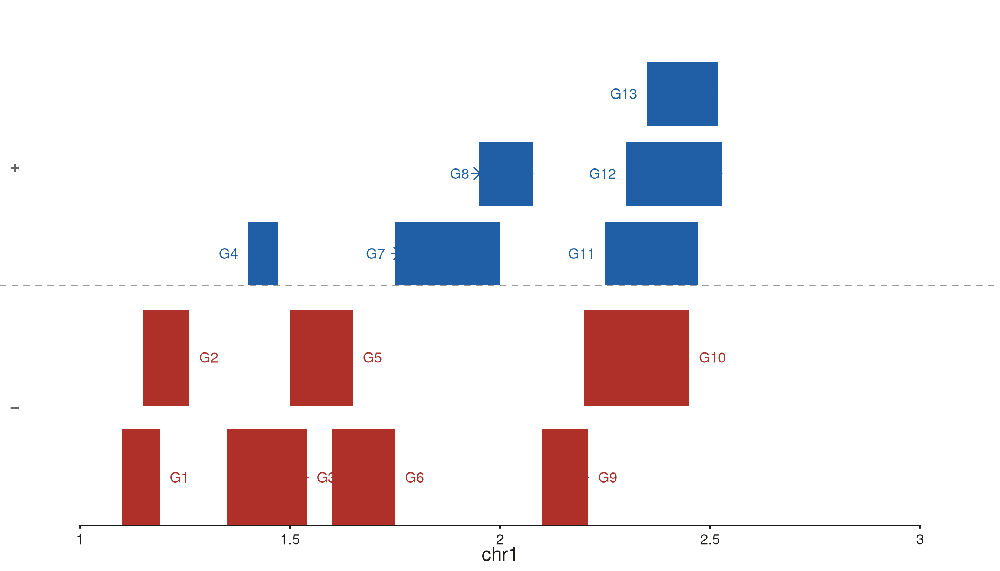

### `seq_sequence` — IGV-style nucleotide display

[`seq_sequence()`](http://andrewlynch.io/SeqPlotR/reference/seq_sequence.md)
renders a coloured rectangle for each nucleotide in windows up to 200 bp
wide. Wider windows emit a message and render nothing. Colours follow
the UCSC standard by default: `A` green, `T` red, `C` blue, `G`
orange/gold. Each rectangle is drawn at 99 % of its slot width so a thin
gap separates adjacent bases.

Supply the nucleotides via `sequence` (a character string) or have them
fetched automatically from a BSgenome package via `genome`. Set
`show_letters = TRUE` to overlay the base letter for windows ≤ 80 bp.

``` r

seq50  <- paste(rep(c("A","T","C","G","G","A","C","T","T","A"), 5), collapse = "")
win50  <- GRanges("chr1", IRanges(1, 50))

seq_plot() %|%
  seq_track(windows = win50, track_height = 0.7) %+%
  seq_sequence(sequence = seq50, show_letters = TRUE) -> p
p$plot()
```

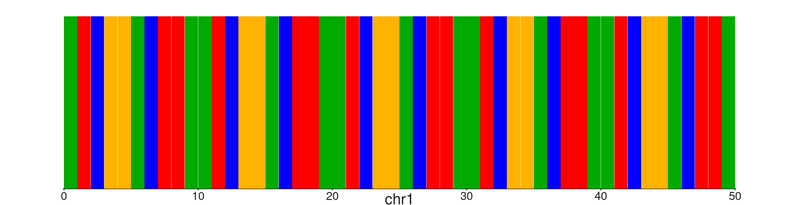

#### Blocks-only view for wider windows

When the window is between 80 and 200 bp the letters are suppressed
(`show_letters` is silently ignored) but the coloured blocks still
render. This gives a compact composition pattern view without the
clutter of overlapping labels.

``` r

seq100 <- paste(rep(c("A","T","C","G"), 25), collapse = "")
win100 <- GRanges("chr1", IRanges(1, 100))

seq_plot() %|%
  seq_track(windows = win100, track_height = 0.7) %+%
  seq_sequence(sequence = seq100) -> p
p$plot()
```

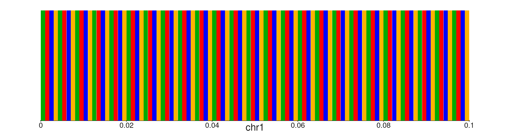

#### Custom colors

Pass a named character vector to `colors` to override any or all of the
UCSC defaults. Below, a soft pastel palette is used to make the track
less visually dominant when layered with other elements.

``` r

pastel <- c(A = "#A8D8A8", T = "#F4A7A7", C = "#A7C4F4", G = "#FAD9A1",
            N = "#DDDDDD")

seq_plot() %|%
  seq_track(windows = win50, track_height = 0.7) %+%
  seq_sequence(sequence = seq50, show_letters = TRUE, colors = pastel) -> p
p$plot()
```

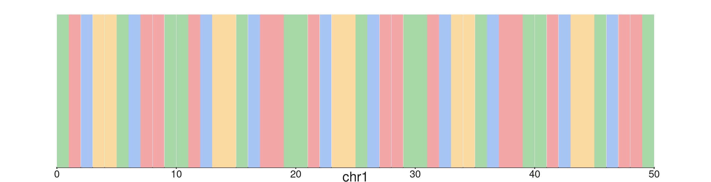

#### Stacked with a coverage track

`rect_height` reserves a fraction of the track height for the rectangles
— useful when placing `seq_sequence` above a signal track. The sequence
track gets a short `track_height` allocation so the coverage area
dominates.

``` r

win60  <- GRanges("chr1", IRanges(1, 60))
seq60  <- paste(rep(c("A","C","G","T"), 15), collapse = "")

cov_xs60 <- seq(1, 60, length.out = 60)
cov_gr60 <- GRanges("chr1", IRanges(start = cov_xs60, width = 1),
                    depth = 0.4 + 0.4 * sin(seq(0, 2 * pi, length.out = 60)))

seq_plot() %|%
  seq_track(windows = win60, track_height = 0.55) %+%
    seq_sequence(sequence = seq60,
                 show_letters = TRUE,
                 rect_height  = 0.7) %__%
  seq_track(data = cov_gr60,
            mapping = map(x = start, y = depth),
            windows = win60) %+%
    seq_area(aesthetics = aes(fill = "#4385BE",
                              color = "#205EA6",
                              alpha = 0.65,
                              linewidth = 0.8)) -> p
p$plot()
```

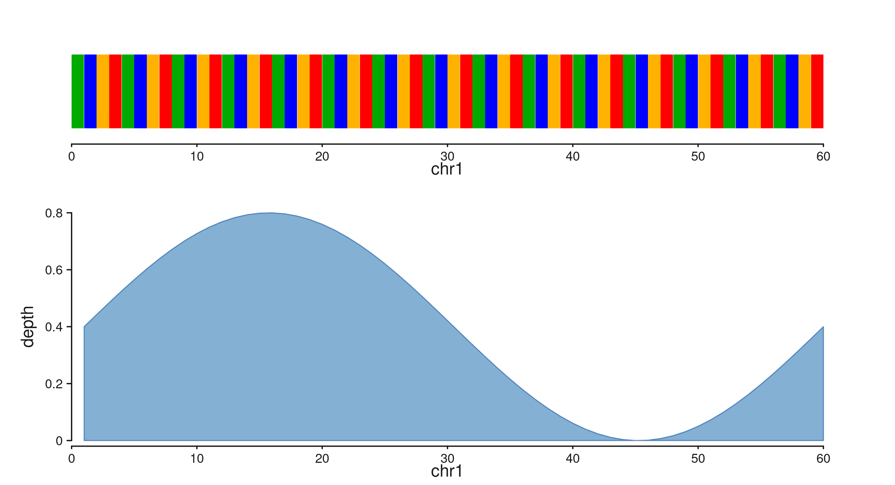

## `seq_ideogram` — chromosome bands

[`seq_ideogram()`](http://andrewlynch.io/SeqPlotR/reference/seq_ideogram.md)
consumes a `GRanges` of cytogenetic bands with a `gieStain` mcol and
draws each band as a Giemsa-shaded rectangle. Paired `acen` bands
collapse into two red triangles meeting at the centromere. Load the
bundled hg38 cytoband table with
\[[`load_cytobands()`](http://andrewlynch.io/SeqPlotR/reference/load_cytobands.md)\].

### A single chromosome

`create_genome_windows("chr1")` expands to a GRanges spanning the full
chromosome, so the ideogram fills the panel end-to-end.

``` r

cb <- load_cytobands()

seq_plot() %|%
  seq_track(track_id = "chr1",
            windows = create_genome_windows("chr1")) %+%
  seq_ideogram(data = cb) -> p
p$plot()
```

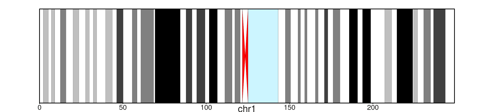

### Multi-chromosome strip

A `windows` GRanges with multiple ranges lays each chromosome out in its
own panel inside the same track. A handful of chromosomes stacked
side-by-side gives an at-a-glance karyotype.

``` r

karyo_win <- create_genome_windows(c("chr1", "chr4", "chr7",
                                     "chr14", "chrX"))

seq_plot() %|%
  seq_track(track_id = "Karyotype",
            windows = karyo_win) %+%
  seq_ideogram(data = cb) -> p
p$plot()
```

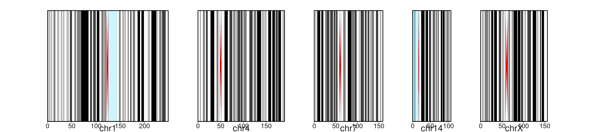

### Scope and style

`scope = "full"` renders the whole chromosome and overlays a translucent
box marking `highlight_range`. `style = "rounded"` adds rounded telomere
caps; `telomere.radius = 1` gives a full half-circle.

``` r

cb <- load_cytobands()
chr1_full <- GRanges("chr1", IRanges(1, 248956422))
zoom_in   <- GRanges("chr1", IRanges(1.2e8, 1.6e8))

p <- seq_plot() %+%
  seq_track(windows = zoom_in, height = 1.5) %+%
   seq_ideogram(cb,
                scope           = "full",
                style           = "rounded",
                highlight_range = zoom_in,
                aesthetics = aes(
                  highlight       = aes(fill = "red", alpha = 0.5),
                  telomere.radius = 1
                ))
p$plot()
```

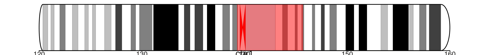

## `seq_scalebar` — length reference

[`seq_scalebar()`](http://andrewlynch.io/SeqPlotR/reference/seq_scalebar.md)
draws a horizontal length reference at a panel position, useful when the
x-axis is hidden. The label auto-formats from the length (`1e5` is
`"100 kb"`, `2e6` is `"2 Mb"`, `500` is `"500 bp"`); override with
`label = "..."`.

``` r

win_sb <- GRanges("chr1", IRanges(1, 1e6))

p <- seq_plot() %+%
  (seq_track(
     windows    = win_sb,
     aesthetics = aes("axis.x1.visible" = FALSE)) %+%
   seq_scalebar(length_bp = 1e5,
                hjust     = 0.95,
                vjust     = 0.5,
                bar_lwd   = 1.5))
p$plot()
```


## Flipping the axes

By default every `seq_track` runs **genomic x** along its width and lets
elements choose the y-axis scale from their data. Pass
`scale_y = seq_scale_genomic(...)` to flip the track so genomic position
runs along **y** instead; then set `scale_x = seq_scale_continuous(...)`
(or `seq_scale_discrete(...)`) to carry a scalar / categorical value on
the x-axis. The same data can be rendered either way.

[`seq_track()`](http://andrewlynch.io/SeqPlotR/reference/seq_track.md)
exposes three arguments that drive this:

- `scale_x` — controls the x-axis scale (defaults to the genomic range
  of the track’s `windows`).
- `scale_y` — controls the y-axis scale. `seq_scale_genomic(...)`
  auto-enables `uses_genomic_y`.
- `y_windows` — shorthand to set a genomic y-range without constructing
  a scale object.

### Same gene set, two orientations

A small gene-level table (`log2fc` per gene, one point per gene):

``` r

gene_meta <- GRanges("chr1",
  IRanges(start = seq(1.1e6, 2.9e6, length.out = 14), width = 1e4),
  log2fc = c(-2.4, -1.3, 0.9, 2.1,  1.6, -0.5,  2.7,
              0.4, -1.8,  1.2, 0.2,  0.8, -2.2,  1.1),
  sig    = c("down","down","ns","up","up","ns","up",
             "ns","down","up","ns","ns","down","up"))

sig_cols <- c(up = "#AF3029", down = "#205EA6", ns = "#878580")
```

**Genomic x, scalar y (conventional).** `x = start` runs along the 1–3
Mb genomic window; `y = log2fc` is scalar.

``` r

seq_plot() %|%
  seq_track(data = gene_meta,
            mapping = map(x = start, y = log2fc, color = sig),
            windows = win) %+%
  seq_segment(mapping = map(x = start, x_end = start,
                            y = 0, y_end = log2fc, color = sig),
              aesthetics = aes(linewidth = 2)) %+%
  seq_point(aesthetics = aes(size = 0.9)) -> p
p$plot()
#> 14 out-of-bounds data points excluded! (seq_point)
```

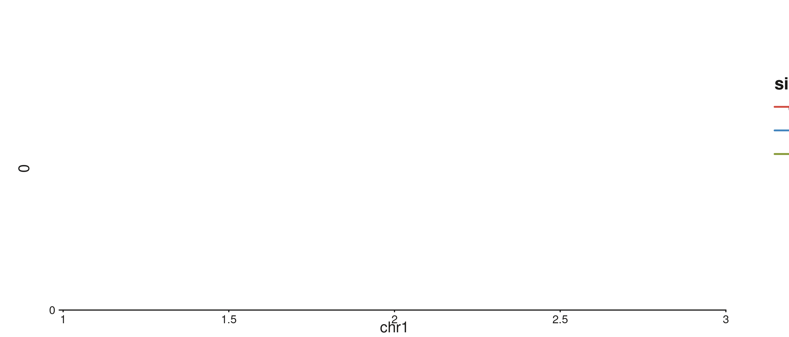

**Scalar x, genomic y (flipped).** `scale_x` carries `log2fc` in
`[-3, 3]`; `scale_y = seq_scale_genomic(win)` puts genomic position on
the vertical axis. The lollipops now fan out horizontally from `x = 0`,
with one row per gene at its true genomic coordinate.

``` r

seq_plot() %|%
  seq_track(data = gene_meta,
            mapping = map(x = log2fc, y = mid, color = sig),
            windows = win,
            scale_x = seq_scale_continuous(limits = c(-3, 3)),
            scale_y = seq_scale_genomic(win),
            track_width = 0.6) %+%
  seq_segment(mapping = map(x = 0, x_end = log2fc,
                            y = mid, y_end = mid, color = sig),
              aesthetics = aes(linewidth = 2)) %+%
  seq_point(aesthetics = aes(size = 0.9)) -> p
p$plot()
```

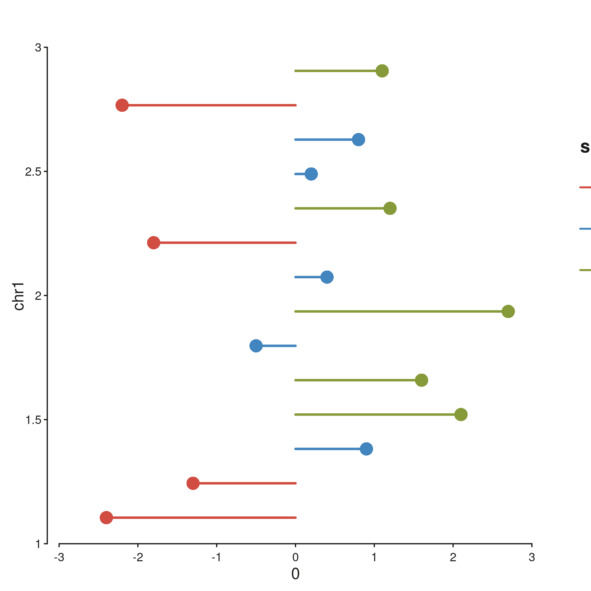

The two plots encode the same table — only the orientation of the
genomic axis changes. In the flipped version the y-tick labels fall back
to Mb units (the genomic `yScaleFactor`, matching the x-axis default) so
`1.5 Mb` reads as `1.5` rather than `1,500,000`.

### Coverage signal flipped onto the y-axis

The same principle extends to continuous signal. Below, a coverage curve
is shown first in the conventional orientation, then flipped so depth
runs along x and genomic position along y — useful as a narrow sidebar
next to a wider browser panel.

``` r

cov_xs <- seq(1.05e6, 2.95e6, length.out = 200)
cov_gr <- GRanges("chr1", IRanges(cov_xs, width = 1),
                  depth = 0.5 + 0.3 * sin((cov_xs - 1e6) / 3e5))
```

``` r

seq_plot() %|%
  seq_track(data = cov_gr,
            mapping = map(x = start, y = depth),
            windows = win) %+%
  seq_area(aesthetics = aes(fill = "#4385BE",
                            color = "#205EA6",
                            alpha = 0.6, linewidth = 0.7)) -> p
p$plot()
```

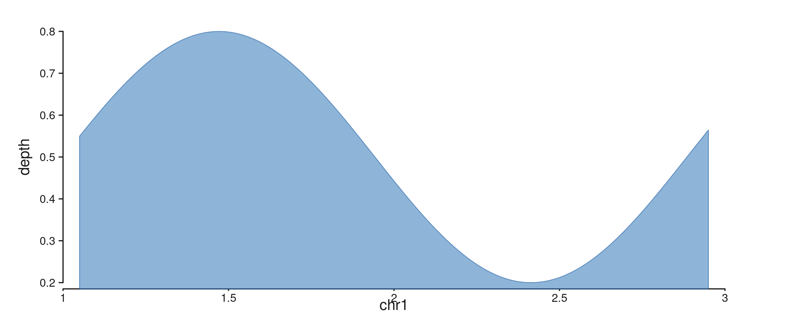

``` r

seq_plot() %|%
  seq_track(data = cov_gr,
            mapping = map(x = depth, y = start),
            windows = win) %+%
  seq_area(aesthetics = aes(fill = "#4385BE",
                            color = "#205EA6",
                            alpha = 0.6, linewidth = 0.7)) -> p
p$plot()
```

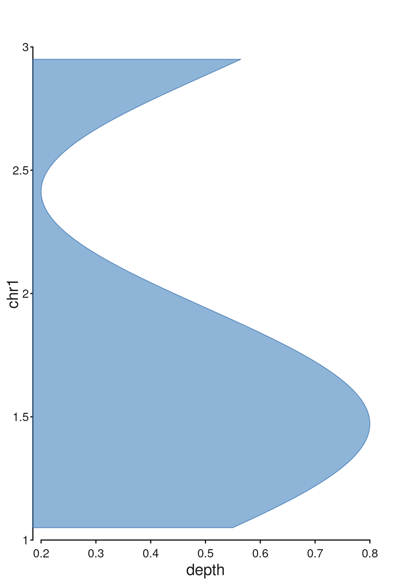
