# Genomic Data: Wrappers, Hi-C, and File Connections

Wrapper functions assemble common genomic visualisations from the
primitive elements. Each returns a `seq_plot` that can be composed
further with `%+%`, `%|%`, `%__%` or
[`seq_resolve()`](http://andrewlynch.io/SeqPlotR/reference/seq_resolve.md).
Pass unique `track_id` values to each wrapper to avoid collisions when
resolving several plots into one figure.

``` r

library(SeqPlotR)
#> 
#> Attaching package: 'SeqPlotR'
#> The following object is masked from 'package:base':
#> 
#>     %||%
library(GenomicRanges)
#> Loading required package: stats4
#> Loading required package: BiocGenerics
#> Loading required package: generics
#> 
#> Attaching package: 'generics'
#> The following objects are masked from 'package:base':
#> 
#>     as.difftime, as.factor, as.ordered, intersect, is.element, setdiff,
#>     setequal, union
#> 
#> Attaching package: 'BiocGenerics'
#> The following objects are masked from 'package:stats':
#> 
#>     IQR, mad, sd, var, xtabs
#> The following objects are masked from 'package:base':
#> 
#>     anyDuplicated, aperm, append, as.data.frame, basename, cbind,
#>     colnames, dirname, do.call, duplicated, eval, evalq, Filter, Find,
#>     get, grep, grepl, is.unsorted, lapply, Map, mapply, match, mget,
#>     order, paste, pmax, pmax.int, pmin, pmin.int, Position, rank,
#>     rbind, Reduce, rownames, sapply, saveRDS, table, tapply, unique,
#>     unsplit, which.max, which.min
#> Loading required package: S4Vectors
#> 
#> Attaching package: 'S4Vectors'
#> The following object is masked from 'package:utils':
#> 
#>     findMatches
#> The following objects are masked from 'package:base':
#> 
#>     expand.grid, I, unname
#> Loading required package: IRanges
#> Loading required package: Seqinfo

# simulated scenarios: copy-number segments per scenario
sim <- function(sc, f) utils::read.delim(system.file("extdata", "sim", sc, f, package = "SeqPlotR"))
scen <- c(bfb = "bfb", wgd = "wgd", ct = "ct", ct_bfb = "ct_bfb")
segs <- lapply(scen, sim, f = "segments.tsv")
```

## Copy number and ChIP

### `seq_copynumber()`

Single-sample CN scatter coloured by integer state, with an optional
segmentation overlay. `cn_col` falls back through
`c("cn", "copy_number", "CN", "state", "integer_cn")` and `ratio_col`
through `c("log2ratio", "logR", "log2R", "ratio", "log2_ratio")`.

The example is a simulated tumour with chromothripsis and
breakage-fusion-bridge amplification on chr4. The simulation provides
copy-number segments but no read-level ratios, so the points are 100 kb
bins across chr4:55-125 Mb. Each bin takes the copy number of the
segment containing it and a log2 ratio of `log2(cn / 2)`, the ratio
expected for that copy number against a diploid reference, so copy
number 2 sits at 0 and copy number 1 at -1. The segment overlay uses the
same ratio computed once per segment.

``` r

sg  <- segs$ct_bfb
win_cn <- GRanges("chr4", IRanges(5.5e7, 1.25e8))

# 100 kb bins labelled by the overlapping segment
bin_start <- seq(5.5e7, 1.25e8 - 1e5, by = 1e5)
bins <- GRanges("chr4", IRanges(bin_start, width = 1e5))
seg_gr <- GRanges(sg$chrom, IRanges(sg$start, sg$end), cn = sg$cn,
                  seg_mean = log2(sg$cn / 2))
hit <- findOverlaps(bins, seg_gr, select = "first")
bins$cn        <- seg_gr$cn[hit]
bins$log2ratio <- log2(bins$cn / 2)

p <- seq_copynumber(bins, windows = win_cn,
                    segment_data = seg_gr, segment_col = "seg_mean")
p$plot()
#> 5 out-of-bounds data points excluded! (seq_segment)
```

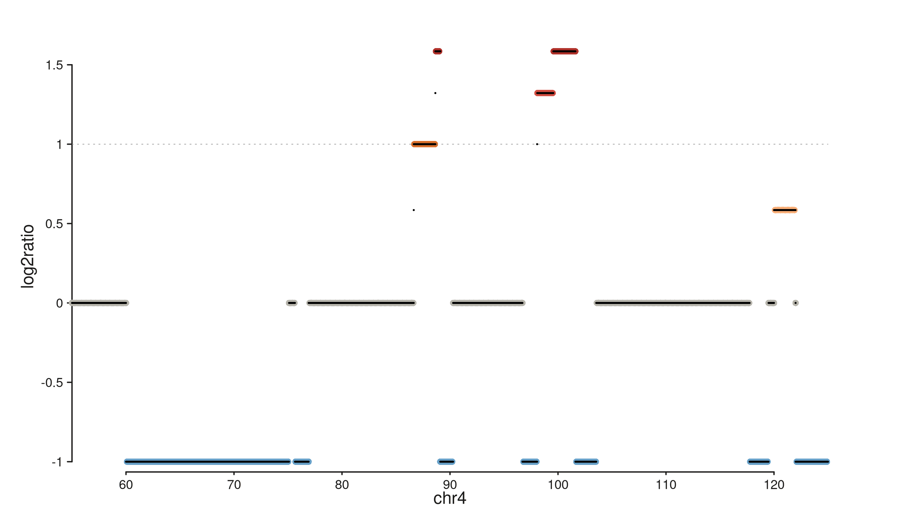

### `seq_cn_heatmap()`

Multi-sample CN heatmap with one row per sample and tiles coloured by CN
state. The rows here are the four simulated scenarios, each covering
different chromosomes: the chr2 amplicon (`bfb`), chr1-3 after genome
doubling (`wgd`), chromothripsis on chr3 (`ct`) and chromothripsis with
amplification on chr4 (`ct_bfb`). One window per chromosome puts every
scenario on a shared chr1-chr4 layout, so each row has tiles only where
that scenario has segments.

``` r

cnh_gr <- do.call(c, unname(Map(function(s, nm) {
  GRanges(s$chrom, IRanges(s$start, s$end), sample = nm, cn = s$cn)
}, segs, names(segs))))
#> Warning in .merge_two_Seqinfo_objects(x, y): The 2 combined objects have no sequence levels in common. (Use
#>   suppressWarnings() to suppress this warning.)

win_hm <- GRanges(paste0("chr", 1:4),
                  IRanges(1, c(248956422, 242193529, 198295559, 190214555)))

p <- seq_cn_heatmap(cnh_gr, windows = win_hm,
                    sample_col = "sample", cn_col = "cn",
                    sample_order = names(segs))
p$plot()
```

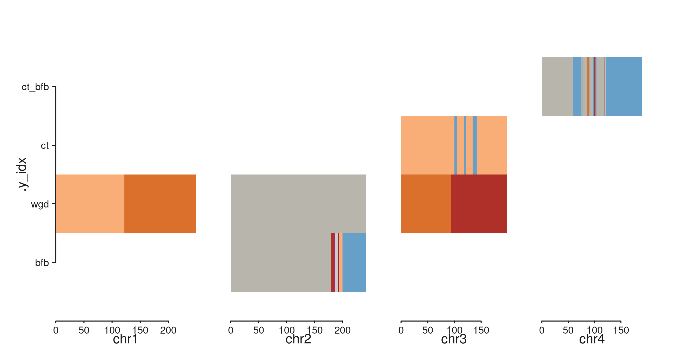

### `seq_chip()`

ChIP-style signal and peak tracks. `data` is a named list of `GRanges`
(one per sample) or a single `GRanges` with a sample column.

``` r

make_sig <- function(nm) {
  g <- GRanges("chr1",
               IRanges(sort(sample(1:1e6, 400)), width = 500),
               score = rexp(400, rate = 0.15))
  S4Vectors::mcols(g)$sample <- nm
  g
}
sig <- list(Rad21 = make_sig("Rad21"), NippedB = make_sig("NippedB"))
peaks <- list(Rad21   = GRanges("chr1", IRanges(sort(sample(1:1e6, 20)), width = 2000)),
              NippedB = GRanges("chr1", IRanges(sort(sample(1:1e6, 15)), width = 2000)))

p <- seq_chip(sig, peaks = peaks,
              windows = GRanges("chr1", IRanges(1, 1e6)))
p$plot()
```

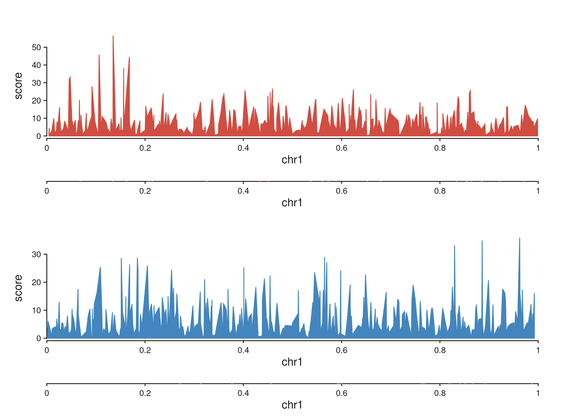

## Hi-C

[`seq_hic()`](http://andrewlynch.io/SeqPlotR/reference/seq_hic.md)
renders contact matrices in four styles. Each call produces one
`seq_plot` with a single track; combine styles or regions by calling it
several times and composing with
[`seq_resolve()`](http://andrewlynch.io/SeqPlotR/reference/seq_resolve.md).

### Synthetic data

A simple contact simulator: every upper-triangular bin pair `(i, j)`
gets strength `exp(-distance * decay_rate) * lognormal(noise)`, then is
mirrored to `(j, i)`.

``` r

# contact simulator
generate_hic_matrix <- function(n_bins, decay_rate = 0.2) {
  ij    <- expand.grid(i = seq_len(n_bins), j = seq_len(n_bins))
  upper <- ij$j >= ij$i
  ij    <- ij[upper, , drop = FALSE]
  d     <- ij$j - ij$i
  s     <- pmax(0.01, exp(-d * decay_rate) * rlnorm(nrow(ij), 0, 0.3))
  upper_df <- data.frame(bin_i = ij$i, bin_j = ij$j, strength = s)
  off      <- d > 0
  lower_df <- data.frame(bin_i = ij$j[off], bin_j = ij$i[off],
                         strength = s[off])
  rbind(upper_df, lower_df)
}

# seq_hic-shaped GRanges for a single region
hic_region <- function(chrom, start, end, bin_size, decay = 0.2,
                       seed = NULL) {
  if (!is.null(seed)) set.seed(seed)
  bin_starts <- seq(start, end - bin_size, by = bin_size)
  n          <- length(bin_starts)
  mat        <- generate_hic_matrix(n, decay_rate = decay)
  GRanges(chrom,
          IRanges(bin_starts[mat$bin_i], width = bin_size),
          i_start = bin_starts[mat$bin_i],
          i_end   = bin_starts[mat$bin_i] + bin_size,
          j_start = bin_starts[mat$bin_j],
          j_end   = bin_starts[mat$bin_j] + bin_size,
          score   = mat$strength)
}

# Multi-region: per-chromosome intra-chrom matrices, concatenated.
hic_multi <- function(regions, bin_size, decay = 0.2, base_seed = 100) {
  parts <- lapply(seq_along(regions), function(k) {
    r <- regions[[k]]
    hic_region(r[[1]], r[[2]], r[[3]], bin_size,
               decay = decay, seed = base_seed + k)
  })
  suppressWarnings(do.call(c, parts))
}
```

### Styles

`full` and `diagonal` keep both axes genomic. `triangle` and `rectangle`
rotate by 45 degrees so y is interaction distance; `max_dist` caps that
axis. `triangle` is the usual browser-style view, `rectangle` suits fine
resolutions where only short-range contacts matter, `diagonal` drops the
redundant lower triangle of `full`.

``` r

gr  <- hic_region("chr1", 40e6, 45e6, bin_size = 1e5, decay = 0.25,
                  seed = 1)
win <- GRanges("chr1", IRanges(40e6, 45e6))
```

``` r

seq_hic(gr, windows = win, style = "full")$plot()
```

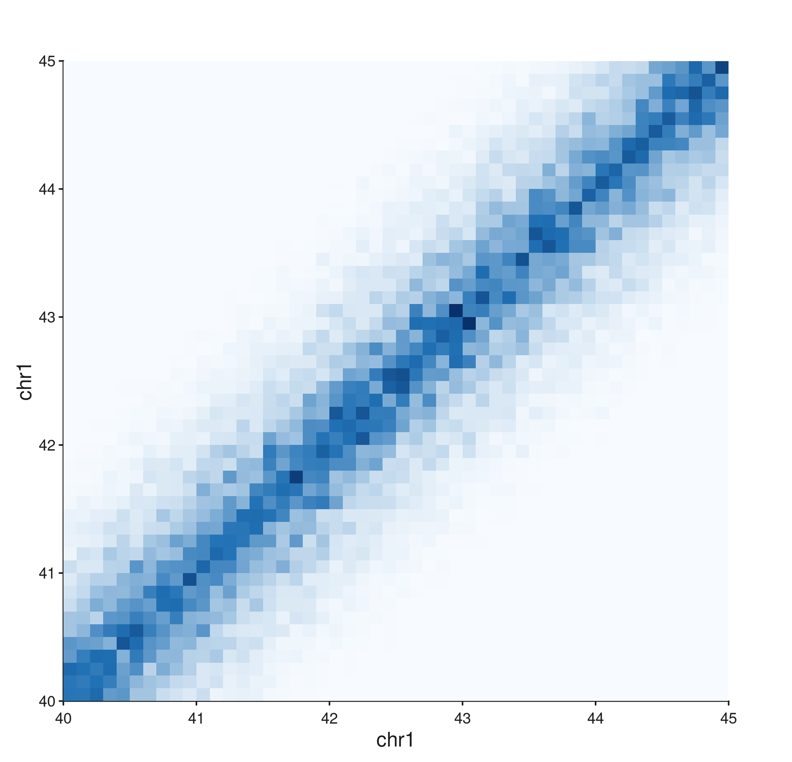

``` r

seq_hic(gr, windows = win, style = "diagonal")$plot()
```

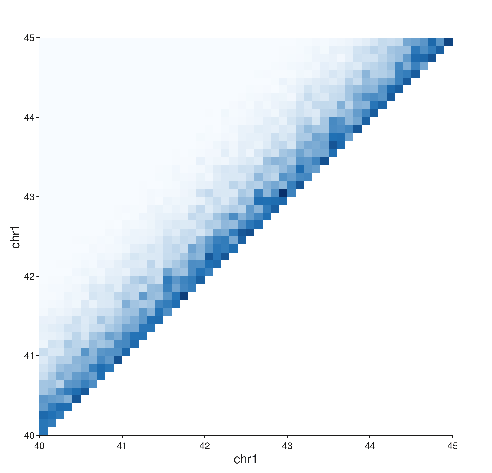

``` r

seq_hic(gr, windows = win, style = "triangle")$plot()
```

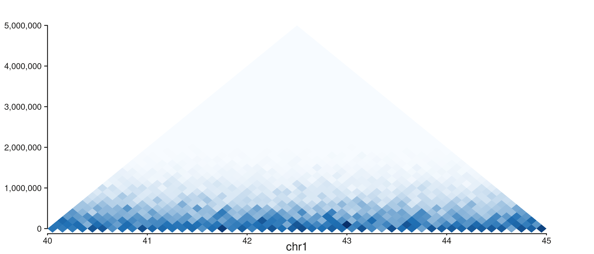

``` r

seq_hic(gr, windows = win, style = "rectangle", max_dist = 2e6)$plot()
```

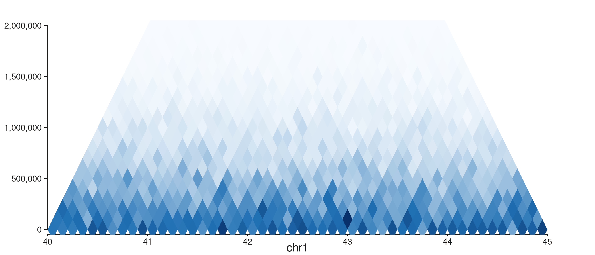

### Multiple regions on x

A multi-range `windows` places each range in its own panel sharing the y
axis. All four styles work this way.

``` r

regs <- list(list("chrA", 0, 3e6),
             list("chrB", 0, 3e6),
             list("chrC", 0, 3e6))
gr_multi <- hic_multi(regs, bin_size = 1e5, decay = 0.25)
win_multi <- GRanges(c("chrA", "chrB", "chrC"),
                     IRanges(c(1, 1, 1), c(3e6, 3e6, 3e6)))
```

``` r

seq_hic(gr_multi, windows = win_multi, style = "triangle")$plot()
```

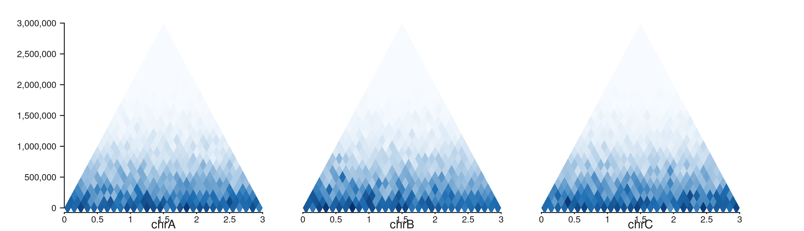

### Multiple regions on y

`y_windows` sets the genomic y-axis for `full` and `diagonal`
independently of `windows`. A multi-region `GRanges` stacks y
sub-panels, each with its own axis. Inter-chromosomal contacts need a
`j_chrom` mcols column giving the j-bin chromosome.

``` r

# x: chr1 (1 region). y: stacked chrA + chrB (2 regions).
# Mixed contact set: chr1×chr1 (intra), chr1↔chrA, chr1↔chrB.
set.seed(7)
n_per <- 250
i_st  <- sort(sample(seq(1, 4e6 - 1e5, by = 1e5), n_per, replace = TRUE))
mk <- function(j_chrom) data.frame(
  i_chrom = "chr1",
  i_start = i_st, i_end = i_st + 1e5,
  j_chrom = j_chrom,
  j_start = sort(sample(seq(1, 4e6 - 1e5, by = 1e5), n_per, replace = TRUE)),
  score   = rexp(n_per, rate = 0.4),
  stringsAsFactors = FALSE
)
df <- rbind(mk("chrA"), mk("chrB"))
df$j_end <- df$j_start + 1e5

gr_multiy <- GRanges(
  df$i_chrom, IRanges(df$i_start, df$i_end),
  i_start = df$i_start, i_end = df$i_end,
  j_chrom = df$j_chrom, j_start = df$j_start, j_end = df$j_end,
  score   = df$score
)

win_x_one <- GRanges("chr1",            IRanges(1, 4e6))
win_y_two <- GRanges(c("chrA", "chrB"), IRanges(c(1, 1), c(4e6, 4e6)))
```

``` r

seq_hic(gr_multiy,
        windows   = win_x_one,
        y_windows = win_y_two,
        style     = "full")$plot()
```

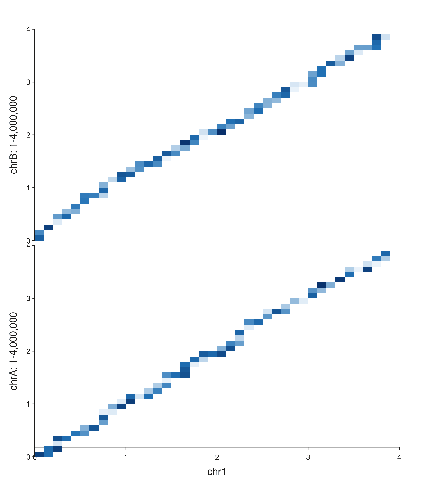

### Combining windows

`combine_windows = TRUE` concatenates the x regions into one virtual
panel so cross-window contacts (for example a translocation) appear in a
single view. It is implemented at
[`seq_track()`](http://andrewlynch.io/SeqPlotR/reference/seq_track.md)
level, so every track type supports it. `combine_y_windows` does the
same on y.

``` r

# Two-region data: intra-chr14, intra-chr5, plus a "translocation"
# band of inter-chromosomal contacts concentrated near a breakpoint.
set.seed(11)
bs   <- 1e5  # bin size
mk_intra <- function(chrom, start, end, decay = 0.25, seed_off = 0) {
  starts <- seq(start, end - bs, by = bs)
  n      <- length(starts)
  set.seed(seed_off)
  mat <- generate_hic_matrix(n, decay_rate = decay)
  data.frame(i_chrom = chrom,  i_start = starts[mat$bin_i],
             i_end   = starts[mat$bin_i] + bs,
             j_chrom = chrom,  j_start = starts[mat$bin_j],
             j_end   = starts[mat$bin_j] + bs,
             score   = mat$strength,
             stringsAsFactors = FALSE)
}
mk_inter <- function(c1, s1, e1, c2, s2, e2, n = 200, focus = c(0.4, 0.7)) {
  i_st <- s1 + round(runif(n, focus[1], focus[2]) * (e1 - s1) / bs) * bs
  j_st <- s2 + round(runif(n, focus[1], focus[2]) * (e2 - s2) / bs) * bs
  rbind(
    data.frame(i_chrom = c1, i_start = i_st, i_end = i_st + bs,
               j_chrom = c2, j_start = j_st, j_end = j_st + bs,
               score   = rexp(n, rate = 0.4) + 0.5,
               stringsAsFactors = FALSE),
    data.frame(i_chrom = c2, i_start = j_st, i_end = j_st + bs,
               j_chrom = c1, j_start = i_st, j_end = i_st + bs,
               score   = rexp(n, rate = 0.4) + 0.5,
               stringsAsFactors = FALSE)
  )
}

intra14 <- mk_intra("chr14", 98e6,  100e6, seed_off = 1)
intra5  <- mk_intra("chr5",  170e6, 172e6, seed_off = 2)
inter   <- mk_inter("chr14", 98e6,  100e6, "chr5", 170e6, 172e6, n = 250)
all_df  <- rbind(intra14, intra5, inter)

gr_combined <- GRanges(
  all_df$i_chrom, IRanges(all_df$i_start, all_df$i_end),
  i_start = all_df$i_start, i_end = all_df$i_end,
  j_chrom = all_df$j_chrom, j_start = all_df$j_start, j_end = all_df$j_end,
  score   = all_df$score
)
win_combined <- GRanges(c("chr14", "chr5"),
                        IRanges(c(98e6, 170e6), c(100e6, 172e6)))
```

``` r

seq_hic(gr_combined,
        windows         = win_combined,
        style           = "triangle",
        combine_windows = TRUE,
        palette         = "reds")$plot()
```

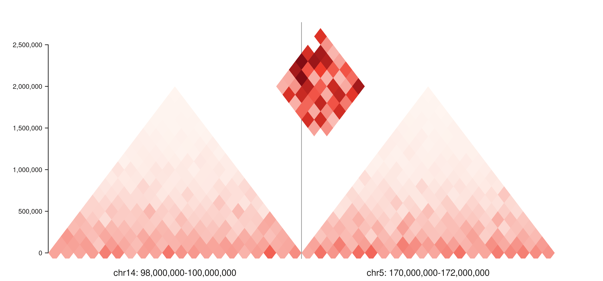

``` r

seq_hic(gr_combined,
        windows           = win_combined,
        y_windows         = win_combined,
        style             = "full",
        combine_windows   = TRUE,
        combine_y_windows = TRUE,
        palette           = "reds")$plot()
```

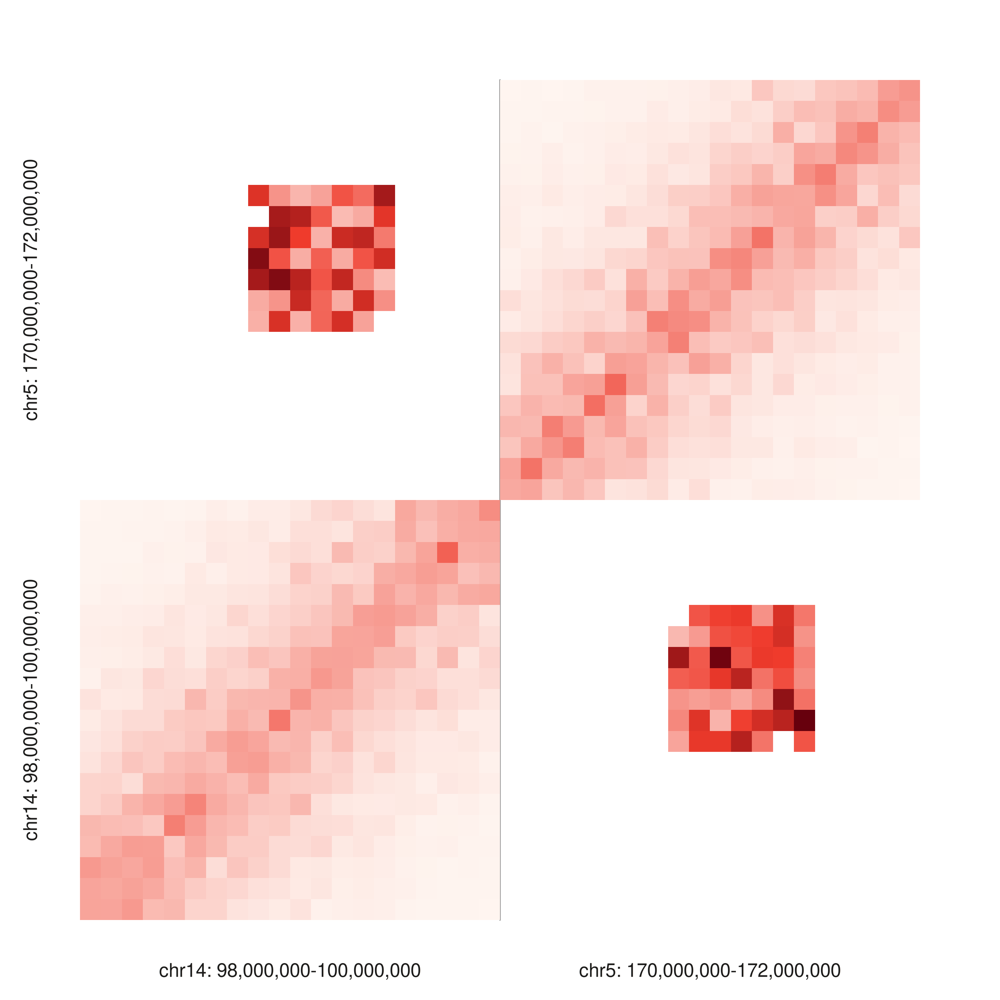

### Region grids

For a matrix-of-matrices view, build one
[`seq_hic()`](http://andrewlynch.io/SeqPlotR/reference/seq_hic.md) per
cell and arrange them with a layout string and
[`seq_resolve()`](http://andrewlynch.io/SeqPlotR/reference/seq_resolve.md).
The diagonal cells are intra-chromosomal; the off-diagonals are the
asymmetric views.

``` r

# Two-region intra-chrom data plus a contrived "off-diagonal" view.
gr_A <- hic_region("chrA", 0, 3e6, bin_size = 1e5, decay = 0.20, seed = 11)
gr_B <- hic_region("chrB", 0, 3e6, bin_size = 1e5, decay = 0.30, seed = 12)
win_A <- GRanges("chrA", IRanges(1, 3e6))
win_B <- GRanges("chrB", IRanges(1, 3e6))
```

``` r

layout <- "
AB
CD
"
p_AA <- seq_hic(gr_A, windows = win_A, style = "full",
                track_id = "A")
p_AB <- seq_hic(gr_A, windows = win_A, y_windows = win_B,
                style = "full", track_id = "B")
p_BA <- seq_hic(gr_B, windows = win_B, y_windows = win_A,
                style = "full", track_id = "C")
p_BB <- seq_hic(gr_B, windows = win_B, style = "full",
                track_id = "D")

fig <- seq_plot(layout = layout)
fig <- seq_resolve(fig, p_AA, p_AB, p_BA, p_BB)
fig$plot()
```

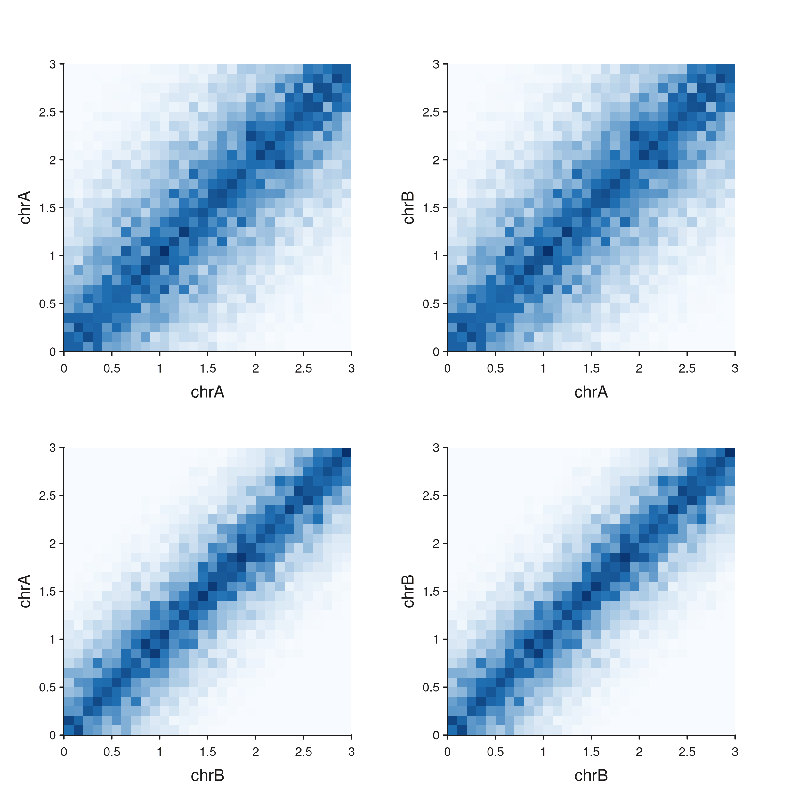

### Flipping axes

`flip_x` and `flip_y` mirror an axis, with tick labels following. A
downward triangle under another track is the common use.

``` r

seq_hic(gr, windows = win, style = "triangle",
        flip_y = TRUE)$plot()
```

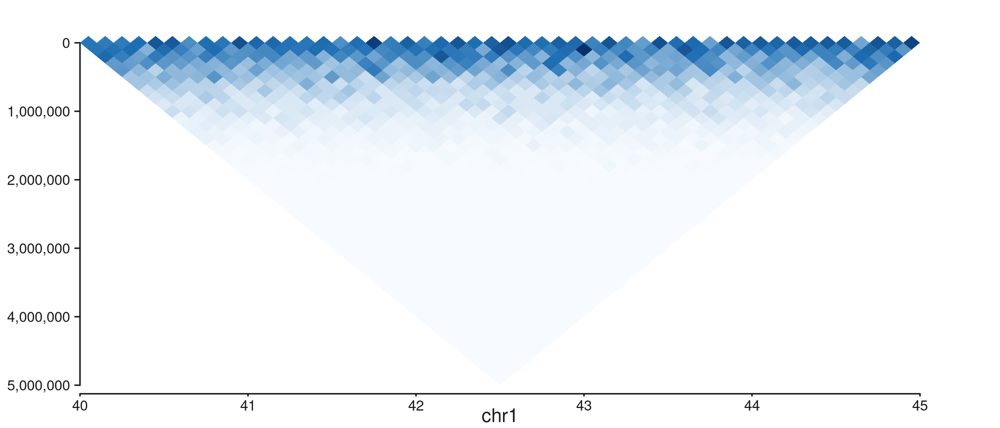

``` r

seq_hic(gr, windows = win, style = "full",
        flip_x = TRUE)$plot()
```

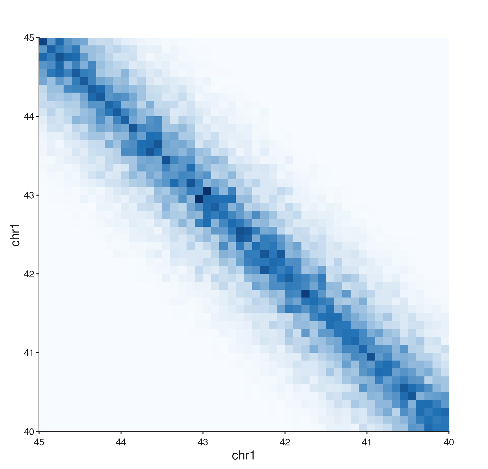

Two samples back-to-back, the second flipped so its peak meets the
first:

``` r

p_top    <- seq_hic(gr, windows = win, style = "triangle",
                    track_id = "top")
p_bottom <- seq_hic(gr, windows = win, style = "triangle",
                    flip_y = TRUE, track_id = "bottom")
seq_resolve(seq_plot(), p_top, p_bottom)$plot()
```

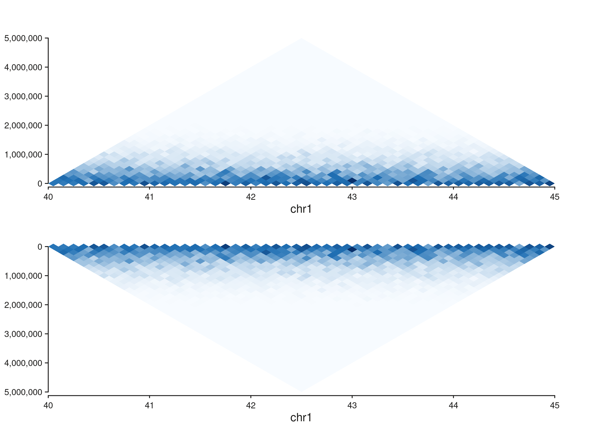

### With annotation tracks

Rotated styles share the x axis with annotation tracks, so
[`seq_resolve()`](http://andrewlynch.io/SeqPlotR/reference/seq_resolve.md)
or the operator chain stacks them directly.

``` r

# Synthetic gene track for the same window.
genes <- GRanges("chr1",
                 IRanges(start = c(40.5e6, 41.4e6, 42.6e6, 43.5e6, 44.2e6),
                         width = c(1.2e5, 2.0e5, 8e4,    1.5e5, 9e4)),
                 gene = paste0("g", 1:5),
                 type = "exon",
                 strand = c("+", "-", "+", "+", "-"))

p_hic <- seq_hic(gr, windows = win, style = "triangle",
                 track_id = "HiC")

p_genes <- seq_plot() %+%
  seq_track(data = genes, windows = win, track_id = "Genes",
            track_height = 0.4) %+%
  seq_gene(map(group = gene, type = type, strand = strand,
               label = gene))

seq_resolve(seq_plot(), p_hic, p_genes)$plot()
```

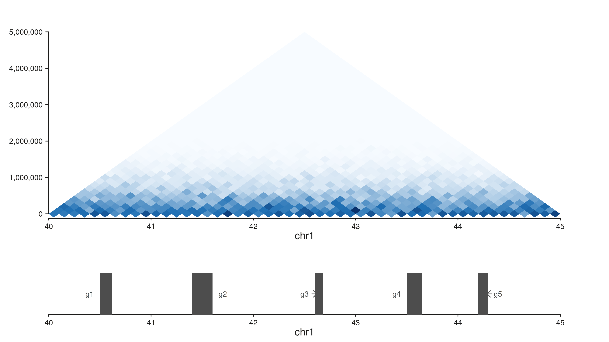

## File connections

[`open_bigwig()`](http://andrewlynch.io/SeqPlotR/reference/open_bigwig.md),
[`open_bam()`](http://andrewlynch.io/SeqPlotR/reference/open_bam.md) and
[`open_hic()`](http://andrewlynch.io/SeqPlotR/reference/open_hic.md)
return lightweight connection objects. Each probes the file header at
construction, records a per-format `max_fetch_bp` guardrail, and exposes
`$fetch(region)` to pull only the requested span. The guardrail fires
before any I/O, so an overly wide span raises an error rather than
loading a whole chromosome.

``` r

bw  <- open_bigwig("path/to/signal.bw")
bw                       # <SeqBigWig>  ...  max_fetch_bp: 50,000,000
sig <- bw$fetch(GRanges("chr1", IRanges(1, 1e6)))   # GRanges of signal

bam <- open_bam("path/to/aln.bam")
bam$fetch(GRanges("chr1", IRanges(20363000, 20370000)))

hic <- open_hic("path/to/contacts.hic", resolution = 25000)
hic$fetch(GRanges("chr1", IRanges(1e7, 1.1e7)))
```

`open_hic()$fetch()` accepts a multi-range `region`: each range yields
its own intra-region contact submatrix and the results are concatenated
into one BEDPE data frame carrying `seqnames1` / `seqnames2`. The
`max_fetch_bp` check applies per range (default 280 Mb).

``` r

hic$fetch(GRanges(c("chr14", "chr15"),
                  IRanges(c(98e6, 50e6), c(99e6, 51e6))))
```

``` r

is_seq_file_conn(list())            # FALSE
#> [1] FALSE
is_seq_file_conn("path/to/file.bw") # FALSE
#> [1] FALSE
```

### `seq_reads()` — alignment view

[`seq_reads()`](http://andrewlynch.io/SeqPlotR/reference/seq_reads.md)
loads alignments from an indexed BAM at construction, packs them into
rows by insert length (or start), and draws chevron polygons (right for
`+`, left for `-`). Mate pairs share a row and are joined by a thin
line. The `max_width` guardrail (default 100 kb) fires before any BAM
I/O.

``` r

win  <- GRanges("chr1", IRanges(20363000, 20370000))
reads <- seq_reads("path/to/aln.bam", win,
                   sort_by    = "insert_length",
                   link_mates = TRUE)

seq_plot() %+%
  (seq_track(windows = win, height = 4) %+% reads)
```

The demo below runs only when `SEQPLOTR_DEMO_BAM` points to an indexed
BAM and Rsamtools and GenomicAlignments are installed.

``` r

win_reads <- GRanges("chr20", IRanges(30000000, 30050000))
reads <- seq_reads(demo_bam, win_reads, max_reads = 500)

p <- seq_plot() %+%
  (seq_track(windows = win_reads, height = 4) %+% reads)
p$plot()
```
