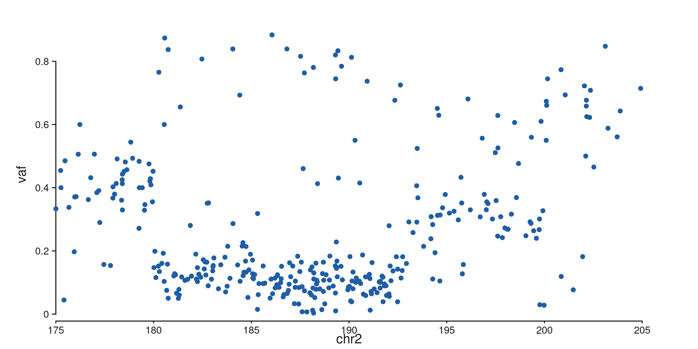
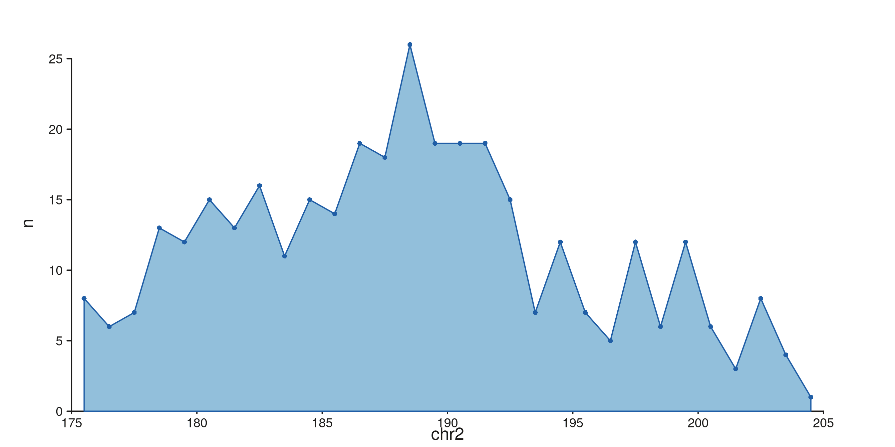
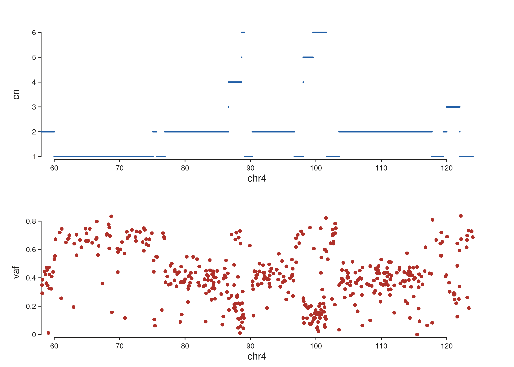

# Getting Started with SeqPlotR

SeqPlotR builds genomic figures by composing a plot, tracks and elements
with a single `%+%` operator. It is modelled on ggplot2 but specialised
for `GRanges` data. This vignette covers the minimum needed to render a
plot end-to-end.

``` r

library(SeqPlotR)
#> 
#> Attaching package: 'SeqPlotR'
#> The following object is masked from 'package:base':
#> 
#>     %||%
library(GenomicRanges)
#> Loading required package: stats4
#> Loading required package: BiocGenerics
#> Loading required package: generics
#> 
#> Attaching package: 'generics'
#> The following objects are masked from 'package:base':
#> 
#>     as.difftime, as.factor, as.ordered, intersect, is.element, setdiff,
#>     setequal, union
#> 
#> Attaching package: 'BiocGenerics'
#> The following objects are masked from 'package:stats':
#> 
#>     IQR, mad, sd, var, xtabs
#> The following objects are masked from 'package:base':
#> 
#>     anyDuplicated, aperm, append, as.data.frame, basename, cbind,
#>     colnames, dirname, do.call, duplicated, eval, evalq, Filter, Find,
#>     get, grep, grepl, is.unsorted, lapply, Map, mapply, match, mget,
#>     order, paste, pmax, pmax.int, pmin, pmin.int, Position, rank,
#>     rbind, Reduce, rownames, sapply, saveRDS, table, tapply, unique,
#>     unsplit, which.max, which.min
#> Loading required package: S4Vectors
#> 
#> Attaching package: 'S4Vectors'
#> The following object is masked from 'package:utils':
#> 
#>     findMatches
#> The following objects are masked from 'package:base':
#> 
#>     expand.grid, I, unname
#> Loading required package: IRanges
#> Loading required package: Seqinfo
```

## The four primitives you need

A SeqPlotR figure is always built from these pieces:

| Piece | What it does |
|----|----|
| [`seq_plot()`](http://andrewlynch.io/SeqPlotR/reference/seq_plot.md) | Creates a new plot. |
| [`seq_track()`](http://andrewlynch.io/SeqPlotR/reference/seq_track.md) | Adds a genomic panel with a `windows` range. |
| `map(...)` | Declares data-driven aesthetics (`x`, `y`, `color`, …). |
| `aes(...)` | Declares constant aesthetics and theme keys. |

Elements (`seq_point`, `seq_line`, `seq_area`, …) are drawn inside a
track. The `%+%` operator chains everything together and dispatches on
the right-hand side’s class.

## A first plot

The examples use simulated tumour data shipped with the package. The
first scenario is a BFB amplicon on chr2 with 1,671 SNVs; each has a
position and a variant allele fraction (`vaf`).

``` r

snv <- utils::read.delim(
  system.file("extdata", "sim", "bfb", "snvs.tsv", package = "SeqPlotR"))
gr  <- GRanges(snv$chrom, IRanges(snv$pos, width = 1), vaf = snv$vaf)
win <- GRanges("chr2", IRanges(1.75e8, 2.05e8))

p <- seq_plot() %+%
  seq_track(data = gr, mapping = map(x = start, y = vaf), windows = win) %+%
  seq_point(aesthetics = aes(color = "#205EA6", size = 0.4))

p$plot()
```



The track holds the defaults (data, mapping, windows); the element
[`seq_point()`](http://andrewlynch.io/SeqPlotR/reference/seq_point.md)
inherits them.

## Layering several elements in one track

`%+%` on a plot adds elements to the **most recently added track**, so
two elements in a row draw on top of each other. Here the SNV count in 1
Mb bins is drawn as an area with a point at each bin:

``` r

in_win <- subsetByOverlaps(gr, win)
counts <- table(floor(start(in_win) / 1e6))
gr_cnt <- GRanges("chr2", IRanges(as.integer(names(counts)) * 1e6 + 5e5, width = 1),
                  n = as.integer(counts))

p <- seq_plot() %+%
  seq_track(data = gr_cnt, mapping = map(x = start, y = n), windows = win) %+%
  seq_area(aesthetics = aes(fill = "#92BFDB", color = "#205EA6", baseline = 0)) %+%
  seq_point(aesthetics = aes(color = "#205EA6", size = 0.3))

p$plot()
```



## Two tracks side by side: `%|%` and `%__%`

`%|%` and `%__%` are convenience aliases for `%+%` that set
`direction = "right"` or `direction = "under"` on the track they
introduce. Below, a second scenario (chromothripsis with BFB on chr4)
shows copy-number segments above the SNVs of the same region:

``` r

seg <- utils::read.delim(
  system.file("extdata", "sim", "ct_bfb", "segments.tsv", package = "SeqPlotR"))
snv4 <- utils::read.delim(
  system.file("extdata", "sim", "ct_bfb", "snvs.tsv", package = "SeqPlotR"))

gr_a <- GRanges(seg$chrom, IRanges(seg$start, seg$end), cn = seg$cn)
gr_b <- GRanges(snv4$chrom, IRanges(snv4$pos, width = 1), vaf = snv4$vaf)
win4 <- GRanges("chr4", IRanges(5.8e7, 1.24e8))

p <- seq_plot() %|%
  seq_track(data = gr_a, mapping = map(x = start, x_end = end, y = cn, y_end = cn),
            windows = win4, track_id = "CN") %+%
  seq_segment(aesthetics = aes(color = "#205EA6", linewidth = 2)) %__%
  seq_track(data = gr_b, mapping = map(x = start, y = vaf),
            windows = win4, track_id = "SNV") %+%
  seq_point(aesthetics = aes(color = "#AF3029", size = 0.4))

p$plot()
```



## Printing

`seq_plot` carries an S3 `print` method, so a bare expression in a
script or knitr chunk auto-renders. `p$plot()` is equivalent.

## Where to go next

- [`vignette("elements", "SeqPlotR")`](http://andrewlynch.io/SeqPlotR/articles/elements.md):
  every drawable element.
- [`vignette("aesthetics", "SeqPlotR")`](http://andrewlynch.io/SeqPlotR/articles/aesthetics.md):
  themes, axes, scales and titles.
- [`vignette("layouts", "SeqPlotR")`](http://andrewlynch.io/SeqPlotR/articles/layouts.md):
  windows, margins, sizing and patchwork layouts.
- [`vignette("links", "SeqPlotR")`](http://andrewlynch.io/SeqPlotR/articles/links.md):
  arcs, arches, SV reconstruction, synteny, zoom and highlights.
- [`vignette("legends", "SeqPlotR")`](http://andrewlynch.io/SeqPlotR/articles/legends.md):
  manual and automatic legends.
- [`vignette("genomic-data", "SeqPlotR")`](http://andrewlynch.io/SeqPlotR/articles/genomic-data.md):
  wrappers, Hi-C and file connections.
