# Layouts: Windows, Margins, Sizing, and Patchwork

SeqPlotR supports two layout modes. **Positional** layouts flow tracks
with `direction = "right"` or `"under"` (the `%|%` and `%__%`
operators). **Patchwork** layouts assign each track to a named rectangle
in a layout string, inspired by
[`patchwork`](https://patchwork.data-imaginist.com). This vignette also
covers the geometry inside a track: windows, margins and sizing.

``` r

library(SeqPlotR)
#> 
#> Attaching package: 'SeqPlotR'
#> The following object is masked from 'package:base':
#> 
#>     %||%
library(GenomicRanges)
#> Loading required package: stats4
#> Loading required package: BiocGenerics
#> Loading required package: generics
#> 
#> Attaching package: 'generics'
#> The following objects are masked from 'package:base':
#> 
#>     as.difftime, as.factor, as.ordered, intersect, is.element, setdiff,
#>     setequal, union
#> 
#> Attaching package: 'BiocGenerics'
#> The following objects are masked from 'package:stats':
#> 
#>     IQR, mad, sd, var, xtabs
#> The following objects are masked from 'package:base':
#> 
#>     anyDuplicated, aperm, append, as.data.frame, basename, cbind,
#>     colnames, dirname, do.call, duplicated, eval, evalq, Filter, Find,
#>     get, grep, grepl, is.unsorted, lapply, Map, mapply, match, mget,
#>     order, paste, pmax, pmax.int, pmin, pmin.int, Position, rank,
#>     rbind, Reduce, rownames, sapply, saveRDS, table, tapply, unique,
#>     unsplit, which.max, which.min
#> Loading required package: S4Vectors
#> 
#> Attaching package: 'S4Vectors'
#> The following object is masked from 'package:utils':
#> 
#>     findMatches
#> The following objects are masked from 'package:base':
#> 
#>     expand.grid, I, unname
#> Loading required package: IRanges
#> Loading required package: Seqinfo

win <- GRanges("chr1", IRanges(1e6, 3e6))
gr  <- GRanges("chr1", IRanges(seq(1.01e6, 2.99e6, length.out = 200), width = 1),
               xv = runif(200, 0, 10), score = rnorm(200))
```

## Coordinate conventions

SeqPlotR automatically selects the x-axis unit from the **narrowest
window** in each track:

| Narrowest window width | Displayed unit | `scale_factor` |
|------------------------|----------------|----------------|
| ≥ 1 Mb (1,000,000 bp)  | Mb             | `1e-6`         |
| ≥ 100 bp               | kb             | `1e-3`         |
| \< 100 bp              | bp             | `1`            |

All windows in a track share the same unit so axis break intervals are
consistent across panels. Override per-track with
`seq_track(window_scale = ...)`, or per-window by setting
`mcols(windows)$scale` directly (highest priority). The examples below
use 2 Mb windows, which auto-infer the Mb unit.

## Positional layout

`track_width` and `track_height` are relative within the row and column
respectively: track `A` below is twice as wide as `B`.

``` r

p_pos <- seq_plot() %+%
  seq_track(data = gr, mapping = map(x = start, y = score),
            windows = win, track_id = "A", track_width = 2) %+% seq_line() %|%
  seq_track(data = gr, mapping = map(x = start, y = score),
            windows = win, track_id = "B") %+% seq_point() %__%
  seq_track(data = gr, mapping = map(x = start, y = score),
            windows = win, track_id = "C") %+% seq_area()

p_pos$plot()
```

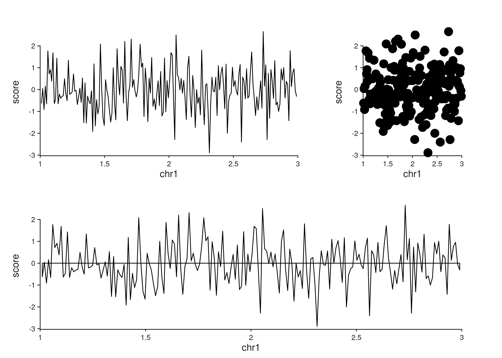

## Tracks, windows, and margins

Every track is allocated a rectangular cell in the page layout and
partitioned into **five nested zones**, two at the track level and three
at the window level:

- **Track outer margin** — outermost band on the track cell. Axis titles
  (taken from the track `mapping`) are drawn here.
  `seq_track(track_outer_margin = ...)`. Default `0.02`.
- **Track inner margin** — separates the title band from the window row.
  `seq_track(track_inner_margin = ...)`. Default `0.02`.
- **Window outer margin** — per-window spacer inside the track plot
  region. `seq_track(window_outer_margin = ...)`. Default `0`.
- **Window inner margin** — per-window band holding axis lines, ticks,
  and tick labels. `seq_track(window_inner_margin = ...)`. Default
  `0.02`.
- **Plot area** — what remains per window. Elements render here;
  `panel$inner` carries these coordinates.

Axis lines sit at the boundary between the plot area and the window
inner margin. The gap between adjacent windows is the plot- or
track-level `aes("window.gap.width" = ...)` (default `0.01`); the gap
between tracks is the plot-level `trackGaps` (default `0.01`). The old
`seq_track(window_margin = ...)` constructor argument is deprecated —
see *Window gap width* below.

The schematic below lays out two tracks × two windows using nothing but
SeqPlotR, with each zone coloured via the plot-level `trackBackground`,
`trackInnerBackground`, `windowBoxBackground`, `windowInnerBackground`,
and `windowBackground` aesthetics. `seq_text` places a label in each
plot area.

``` r

# Two windows (2 Mb and 1.5 Mb wide).
schematic_win <- GRanges(
  "chr1", IRanges(start = c(1e6, 5e6), end = c(3e6, 6.5e6)))

# One label centred inside each window for each track.
mk_labels <- function(track_name) {
  GRanges(
    "chr1", IRanges(start = c(2e6, 5.75e6), width = 1),
    label = paste0(track_name, "\nWindow ", c(1, 2))
  )
}
lbl_A <- mk_labels("Track A")
lbl_B <- mk_labels("Track B")

# Zone colors via plot-level aesthetics; axes turned off so the five
# nested rectangles are visible without interference.
schematic_aes <- aes(
  trackBackground        = "#F89A8A",  # track outer margin
  trackBorder            = "grey30",
  trackInnerBackground   = "#ECCB60",  # track inner margin
  trackInnerBorder       = "grey30",
  windowBoxBackground    = "#A699D0",  # window outer margin
  windowBoxBorder        = "grey30",
  windowInnerBackground  = "#BEC97E",  # window inner margin
  windowInnerBorder      = "grey30",
  windowBackground       = "#92BFDB",  # plot area
  windowBorder           = "grey30",
  xAxisLine = FALSE, xAxisTicks = FALSE, xAxisLabels = FALSE,
  xAxisTitle = FALSE,
  yAxisLine = FALSE, yAxisTicks = FALSE, yAxisLabels = FALSE,
  yAxisTitle = FALSE,
  trackGaps = 0.04,
  "window.gap.width" = 0.03
)

seq_plot(aesthetics = schematic_aes) %|%
  seq_track(track_id = "A",
            data = lbl_A,
            mapping = map(x = start, label = label),
            windows = schematic_win,
            track_outer_margin  = 0.035,
            track_inner_margin  = 0.025,
            window_outer_margin = 0.025,
            window_inner_margin = 0.035) %+%
  seq_text(aesthetics = aes(fontsize = 12, color = "#1C1B1A")) %__%
  seq_track(track_id = "B",
            data = lbl_B,
            mapping = map(x = start, label = label),
            windows = schematic_win,
            track_outer_margin  = 0.035,
            track_inner_margin  = 0.025,
            window_outer_margin = 0.025,
            window_inner_margin = 0.035) %+%
  seq_text(aesthetics = aes(fontsize = 12, color = "#1C1B1A")) -> p
p$plot()
```

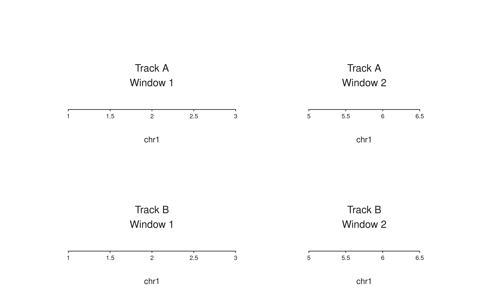

Reading the schematic, from outside to inside on each track:

- **Pink** — track outer margin (axis titles live here).
- **Yellow** — track inner margin.
- **Purple** — window outer margin (per-window spacer).
- **Green** — window inner margin (axis lines, ticks, tick labels live
  here).
- **Blue** — plot area, where elements render.
- The vertical green/blue split inside a track is the **window margin**
  between the two windows.
- The horizontal gap between the two tracks is the **track gap**.

### Window gap width

`aes("window.gap.width" = <npc>)` controls the horizontal gap between
adjacent windows within a track. Set it on
[`seq_plot()`](http://andrewlynch.io/SeqPlotR/reference/seq_plot.md) to
apply across every track, or on a specific
[`seq_track()`](http://andrewlynch.io/SeqPlotR/reference/seq_track.md)
to override the plot-level value for that track only. Default is `0.01`.

``` r

gap_win <- GRanges(
  "chr1",
  IRanges(start = c(1, 1e6 + 1, 2e6 + 1), width = 1e6)
)
gap_lbl <- function(track_name) {
  GRanges(
    "chr1",
    IRanges(start = c(5e5, 1.5e6, 2.5e6), width = 1),
    label = paste0(track_name, "\nW", c(1, 2, 3))
  )
}

# Three tracks, three gap widths: collapsed, default, generous.
seq_plot(aesthetics = aes(
    windowBackground = "#92BFDB", windowBorder = "grey30",
    xAxisLine = FALSE, xAxisTicks = FALSE, xAxisLabels = FALSE,
    xAxisTitle = FALSE, yAxisLine = FALSE, yAxisTicks = FALSE,
    yAxisLabels = FALSE, yAxisTitle = FALSE,
    "window.gap.width" = 0   # plot-level default for all tracks
  )) %|%
  seq_track(track_id = "Collapsed (0)",
            data = gap_lbl("Collapsed"),
            mapping = map(x = start, label = label),
            windows = gap_win) %+%
  seq_text(aesthetics = aes(fontsize = 11)) %__%
  seq_track(track_id = "Default (0.01)",
            data = gap_lbl("Default"),
            mapping = map(x = start, label = label),
            windows = gap_win,
            aesthetics = aes("window.gap.width" = 0.01)) %+%
  seq_text(aesthetics = aes(fontsize = 11)) %__%
  seq_track(track_id = "Generous (0.05)",
            data = gap_lbl("Generous"),
            mapping = map(x = start, label = label),
            windows = gap_win,
            aesthetics = aes("window.gap.width" = 0.05)) %+%
  seq_text(aesthetics = aes(fontsize = 11)) -> p
p$plot()
```

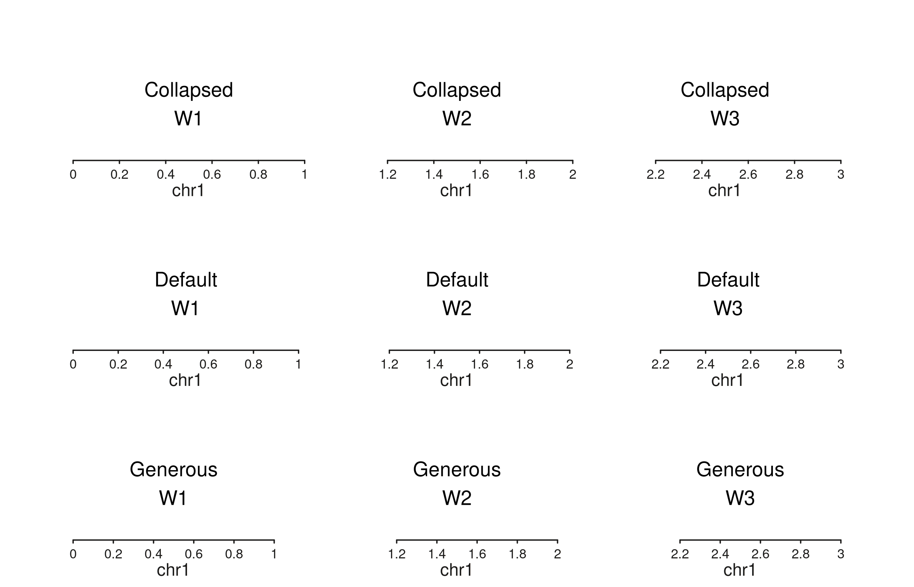

The legacy `seq_track(window_margin = ...)` constructor argument is
deprecated and emits a warning when used; switch to
`aes("window.gap.width" = ...)`. The older `aes(window_gaps = ...)` key
still works as an alias but `window.gap.width` takes priority when both
are set.

### Margin recipes

The five zones are independent knobs. The examples below share a single
small dataset and vary only the margin arguments so the effect of each
one is visible.

``` r

recipe_win <- GRanges("chr1", IRanges(1e6, 3e6))
recipe_gr  <- GRanges(
  "chr1",
  IRanges(start = seq(1.1e6, 2.9e6, by = 2e5), width = 8e4),
  score = runif(10, 0.2, 1.0)
)
```

**Minimal:** drop the axis titles and the track outer margin — the plot
fills the full track cell.

``` r

seq_plot(aesthetics = aes(xAxisTitle = FALSE, yAxisTitle = FALSE)) %|%
  seq_track(data = recipe_gr,
            mapping = map(x = start, y = score),
            windows = recipe_win,
            track_outer_margin = 0,
            window_inner_margin = 0.02) %+%
  seq_bar(aesthetics = aes(fill = "#4385BE")) -> p
p$plot()
```

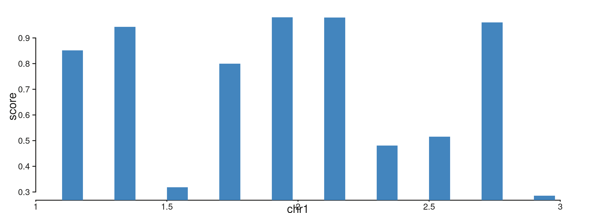

**Room for titles and labels:** widen both track and window margins. The
axis titles (`start`, `score`) auto-populate from the mapping.

``` r

seq_plot() %|%
  seq_track(data = recipe_gr,
            mapping = map(x = start, y = score),
            windows = recipe_win,
            track_outer_margin = c(0.05, 0.05, 0.02, 0.02),
            window_inner_margin = 0.06) %+%
  seq_bar(aesthetics = aes(fill = "#4385BE")) -> p
p$plot()
```

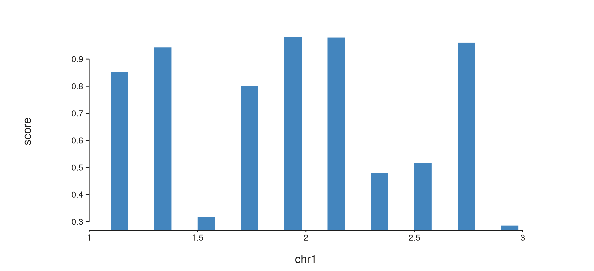

**Asymmetric margins:** the length-4 form uses base-R
`par(mar = c(bottom, left, top, right))` order. Below the x-axis title
gets a wider bottom band; the top edge stays flush.

``` r

seq_plot() %|%
  seq_track(data = recipe_gr,
            mapping = map(x = start, y = score),
            windows = recipe_win,
            track_outer_margin = c(0.06, 0.06, 0, 0),
            track_inner_margin = 0.015,
            window_inner_margin = 0.04) %+%
  seq_bar(aesthetics = aes(fill = "#4385BE")) -> p
p$plot()
```

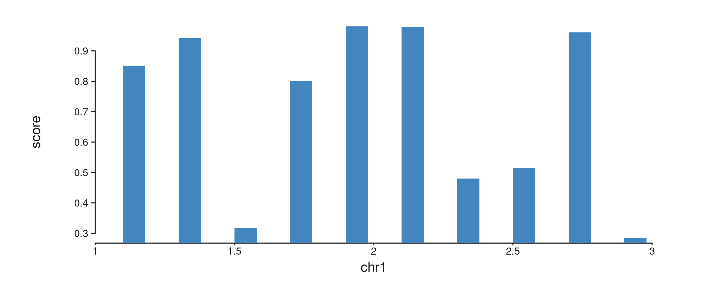

### Plot margin and margin overlay

`seq_plot(plot_margin = )` sets the outermost canvas margin in NPC units
(default `0.02`). `highlight_margins = TRUE` overlays translucent bands
on every margin region while tuning a layout: `plot_margin` red,
`track_outer_margin` dark blue, `track_inner_margin` light blue,
`window_outer_margin` dark green, `window_inner_margin` light green,
plot area pink.

``` r

mk <- function(...) {
  seq_plot(windows = win, ...) %+%
    (seq_track(data = recipe_gr, mapping = map(x = start, y = score),
               track_outer_margin = 0.04, track_inner_margin = 0.03,
               window_outer_margin = 0.02, window_inner_margin = 0.02) %+% seq_bar())
}
mk(plot_margin = 0)$plot()
```

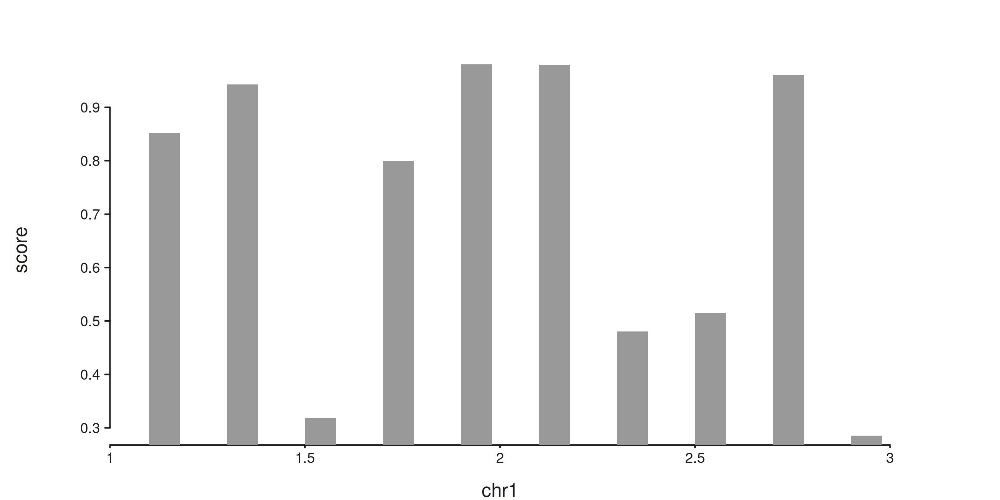

``` r

mk(plot_margin = 0.05, highlight_margins = TRUE)$plot()
```

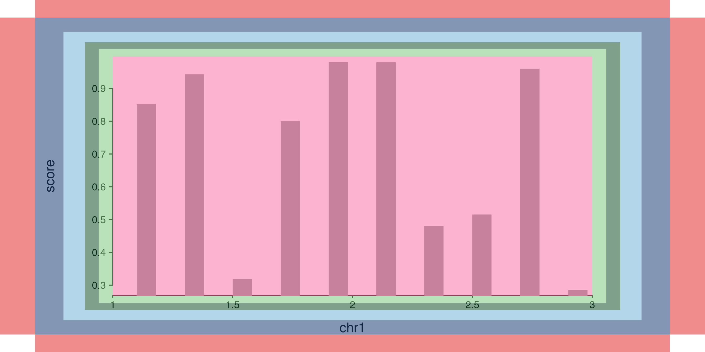

### Track and window sizing

Relative sizing is controlled by three arguments: `track_width` (within
a row), `track_height` (across rows), and the `scale` mcols column on
the `windows` GRanges (within a track’s plot region).

**Unequal track widths on one row.** Track A is 3× wider than B.

``` r

win_small <- GRanges("chr1", IRanges(1e6, 3e6))
gr_small  <- GRanges("chr1",
  IRanges(start = seq(1.1e6, 2.9e6, by = 2e5), width = 8e4),
  score = runif(10, 0.2, 1.0))

seq_plot() %|%
  seq_track(track_id = "A",
            data = gr_small,
            mapping = map(x = start, y = score),
            windows = win_small,
            track_width = 3) %+%
  seq_bar(aesthetics = aes(fill = "#4385BE")) %|%
  seq_track(track_id = "B",
            data = gr_small,
            mapping = map(x = start, y = score),
            windows = win_small,
            track_width = 1) %+%
  seq_lollipop(aesthetics = aes(color = "#AF3029")) -> p
p$plot()
```

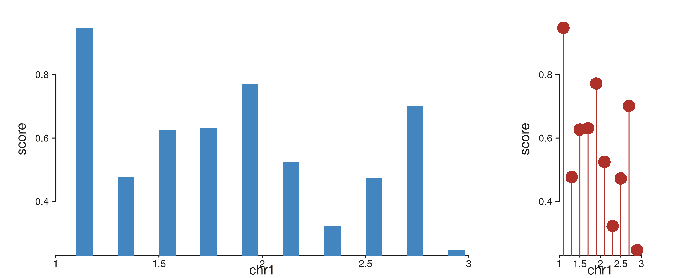

**Unequal track heights on stacked rows.** A points track twice as tall
as the bar track below it.

``` r

xs_sig <- seq(1.05e6, 2.95e6, length.out = 40)
sig_gr <- GRanges("chr1", IRanges(start = xs_sig, width = 1),
                  score = sin((xs_sig - 1e6) / 3e5) * 0.4 + 0.5)

seq_plot() %|%
  seq_track(track_id = "Signal",
            data = sig_gr,
            mapping = map(x = start, y = score),
            windows = win_small,
            track_height = 2) %+%
  seq_line(aesthetics = aes(color = "#4385BE", linewidth = 1.5)) %__%
  seq_track(track_id = "Bars",
            data = gr_small,
            mapping = map(x = start, y = score),
            windows = win_small,
            track_height = 1) %+%
  seq_bar(aesthetics = aes(fill = "#8B7EC8")) -> p
p$plot()
```

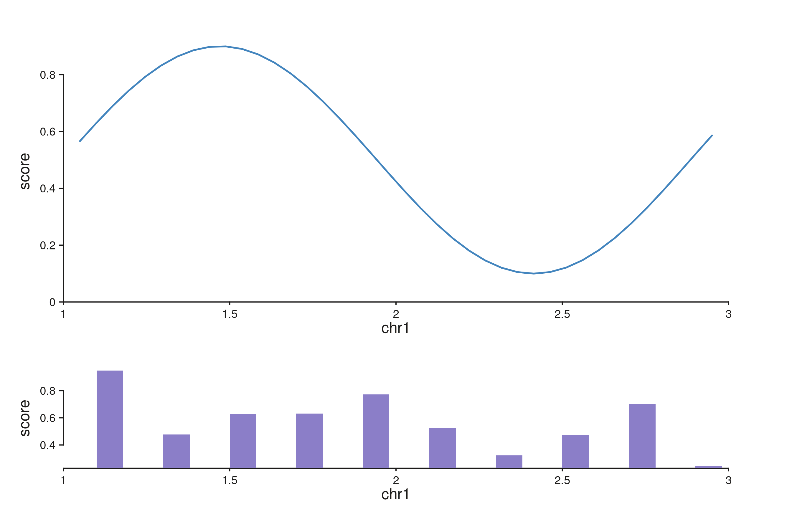

**Per-window scale factor.** Within a multi-window track, windows are
sized by `width(windows) * mcols(windows)$scale`. Defaults to the
auto-inferred scale for all windows. Setting one window’s scale to `0`
shrinks it to nothing; setting distinct scales compresses or expands
individual windows relative to others.

``` r

# Two windows of equal genomic width, but the second rendered at
# 2× the first's relative width.
scaled_win <- GRanges(
  "chr1", IRanges(start = c(1e6, 5e6), end = c(3e6, 7e6)))
S4Vectors::mcols(scaled_win)$scale <- c(1e-6, 2e-6)

scaled_gr <- GRanges("chr1",
  IRanges(start = c(seq(1.2e6, 2.8e6, length.out = 5),
                    seq(5.2e6, 6.8e6, length.out = 5)),
          width = 1e5),
  score = runif(10, 0.2, 1.0))

seq_plot() %|%
  seq_track(data = scaled_gr,
            mapping = map(x = start, y = score),
            windows = scaled_win) %+%
  seq_bar(aesthetics = aes(fill = "#4385BE")) -> p
p$plot()
```

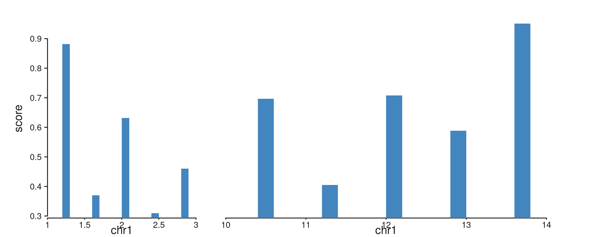

**Track-level unit override with `window_scale`.** Pass `window_scale`
on `seq_track` to force a fixed scale factor for all windows, or a
positional vector to set each window independently. `window_scale`
overrides the auto-inferred unit but is overridden by any
`mcols(windows)$scale` already present. Length-1 applies to all windows;
any other mismatched length triggers a warning and recycles.

``` r

# Two 5 Mb windows — auto-inference gives Mb, but we force kb.
mb_win <- GRanges("chr1", IRanges(start = c(1e6, 1e7 + 1), width = 5e6))
mb_gr  <- GRanges("chr1",
  IRanges(start = c(seq(1.2e6, 5.8e6, length.out = 5),
                    seq(1.02e7, 1.58e7, length.out = 5)),
          width = 2e5),
  score = runif(10, 0.2, 1.0))

seq_plot() %|%
  seq_track(data = mb_gr,
            mapping = map(x = start, y = score),
            windows = mb_win,
            window_scale = 1e-3) %+%
  seq_bar(aesthetics = aes(fill = "#4385BE")) -> p
p$plot()
```

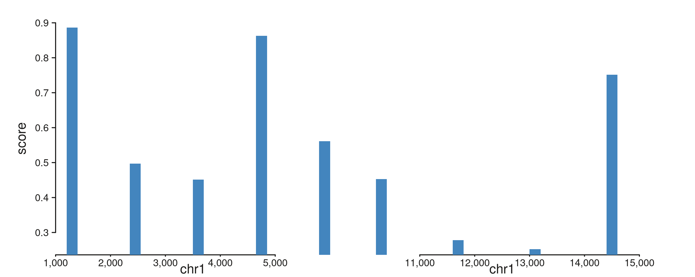

## Multi-region windows

A `windows` GRanges with several ranges lays each out as its own panel
in the same track. Mappings resolve per panel and panel widths follow
`width(windows)`.

``` r

mwin <- GRanges("chr1", IRanges(start = c(1.0e6, 5.0e6), end = c(3.0e6, 6.5e6)))
```

``` r

starts_A <- seq(1.1e6, 2.9e6, length.out = 12)
starts_B <- seq(5.1e6, 6.4e6, length.out = 12)

multi_gr <- GRanges("chr1",
  IRanges(start = c(starts_A, starts_B), width = 5e4),
  score  = runif(24, 0.2, 1.0),
  region = rep(c("A", "B"), each = 12))

seq_plot() %|%
  seq_track(data = multi_gr,
            mapping = map(x = start, y = score, group = region),
            windows = mwin) %+%
  seq_bar() -> p
p$plot()
```

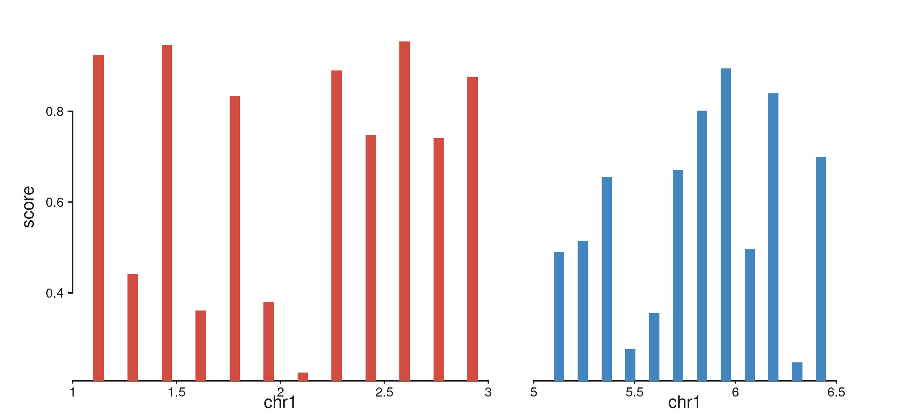

### Inheriting windows

`seq_plot(windows = )` is inherited by tracks without their own windows,
and a bare
[`seq_scale_genomic()`](http://andrewlynch.io/SeqPlotR/reference/seq_scale_genomic.md)
inherits from its track. This removes repeated boilerplate.

``` r

(seq_plot(windows = win) %+%
   (seq_track(data = gr, mapping = map(x = xv, y = score)) %+% seq_point()) %__%
   (seq_track(data = gr, mapping = map(x = start, y = score),
              scale_x = seq_scale_genomic()) %+% seq_point()))$plot()
```

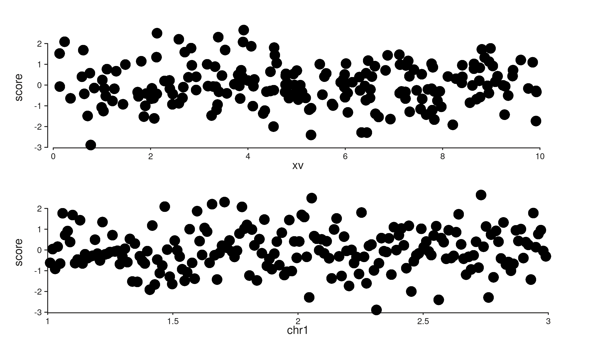

## Patchwork layout strings

Each unique letter is a region and `#` cells stay blank. With a layout
string every track’s `direction` is ignored; placement comes from
matching `track_id` to the letters. Tracks whose `track_id` is absent
from the string are silently skipped, so one chain can be reused across
layouts.

``` r

layout <- "
##AA
##AA
BBBC
BBBD
"
p <- seq_plot(layout = layout) %+%
  seq_track(data = gr, mapping = map(x = start, y = score),
            windows = win, track_id = "A") %+% seq_line() %+%
  seq_track(data = gr, mapping = map(x = start, y = score),
            windows = win, track_id = "B") %+% seq_area()  %+%
  seq_track(data = gr, mapping = map(x = start, y = score),
            windows = win, track_id = "C") %+% seq_bar()   %+%
  seq_track(data = gr, mapping = map(x = start, y = score),
            windows = win, track_id = "D") %+% seq_point()

p$plot()
```

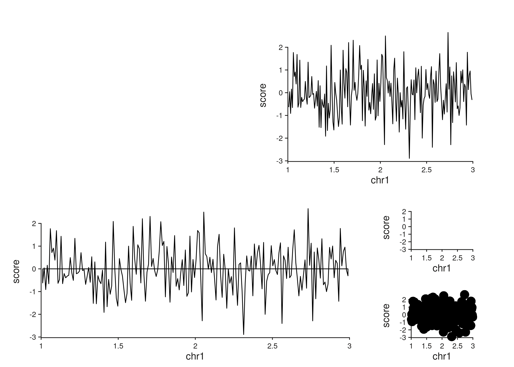

[`seq_preview_layout()`](http://andrewlynch.io/SeqPlotR/reference/seq_preview_layout.md)
validates a layout without data, from a string or from a positional
plot:

``` r

seq_preview_layout(layout = layout)
```

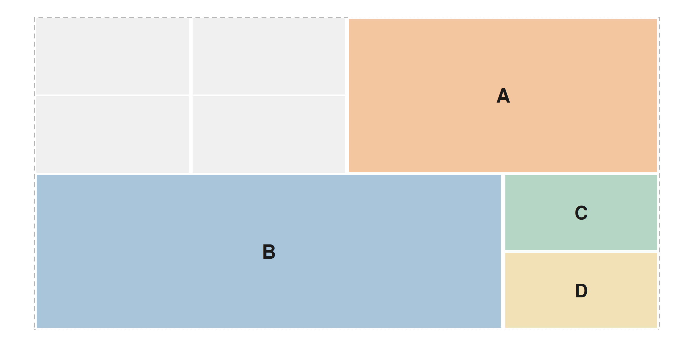

``` r

seq_preview_layout(plot_obj = p_pos)
```

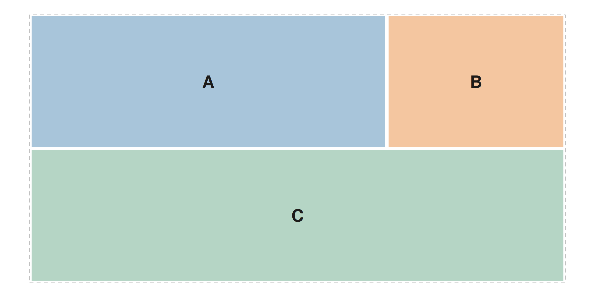

Relative `track_width` / `track_height` apply within a cell, and the
outer cell bounds come from the layout string. A letter can span several
rows or columns as long as its cells form a rectangle (an L-shape is an
error). Here `B` spans two rows on the right and `A` has
`track_height = 2` within its cell:

``` r

span_layout <- "
AABB
AABB
CCCC
"
seq_preview_layout(layout = span_layout)
```

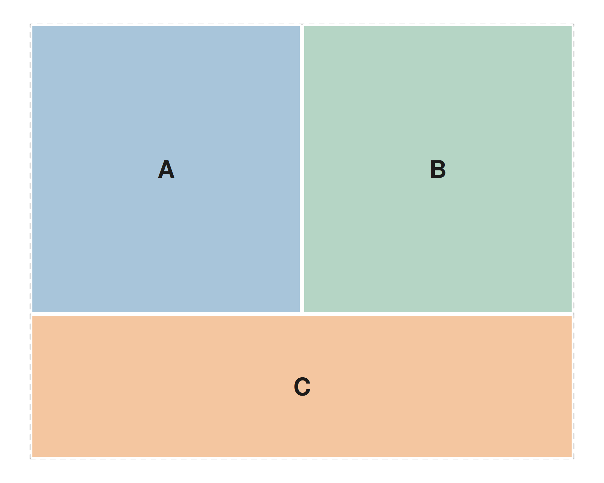

``` r

p <- seq_plot(layout = span_layout) %+%
  seq_track(data = gr, mapping = map(x = start, y = score),
            windows = win, track_id = "A", track_height = 2) %+% seq_line() %+%
  seq_track(data = gr, mapping = map(x = start, y = score),
            windows = win, track_id = "B") %+% seq_bar() %+%
  seq_track(data = gr, mapping = map(x = start, y = score),
            windows = win, track_id = "C") %+% seq_point()
p$plot()
```

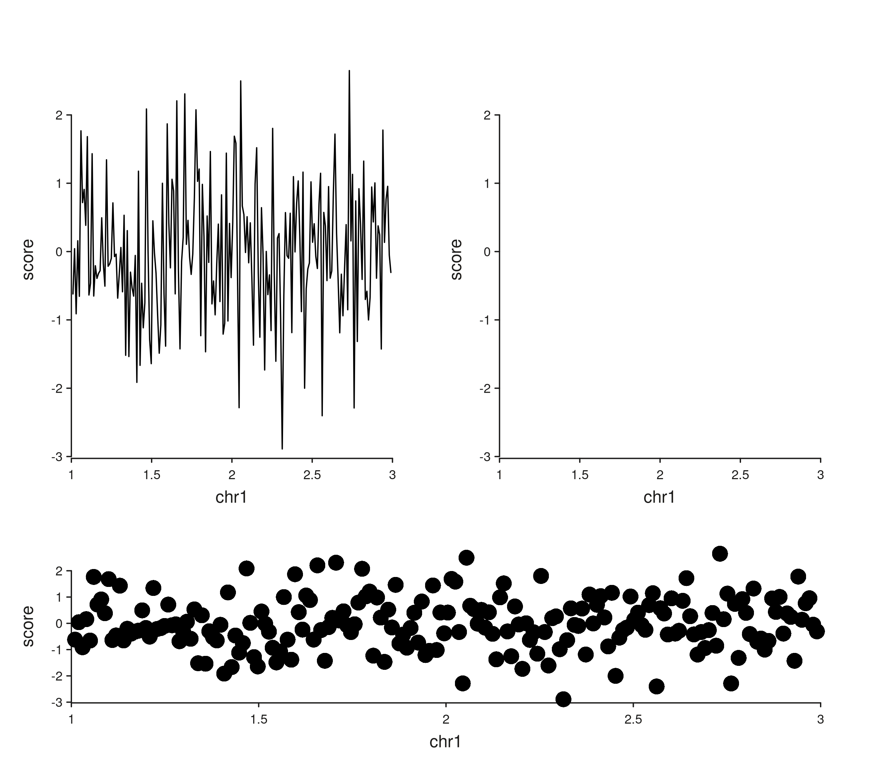

[`seq_preview_circos()`](http://andrewlynch.io/SeqPlotR/reference/seq_preview_circos.md)
draws a minimal circular schematic for whole-genome plots from a
positional plot (patchwork layouts are not supported):

``` r

gw <- default_genome_windows()
circ <- seq_plot() %+%
  seq_track(windows = gw, track_id = "whole_genome") %+% seq_line()
seq_preview_circos(plot_obj = circ)
```

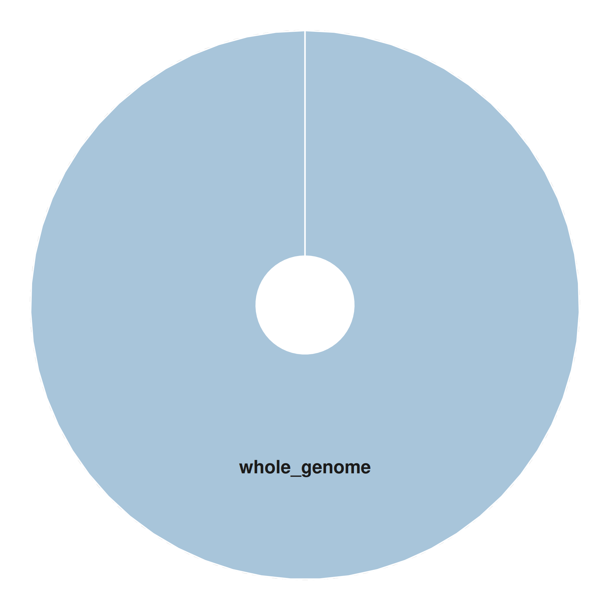

## A genome-browser layout

An ideogram strip, a ribbon with a density sidebar, bar and lollipop
tracks, and gene models across the bottom.

``` r

cb <- load_cytobands()
bar_gr <- GRanges(
  "chr1",
  IRanges(start = seq(1.1e6, 2.9e6, by = 2e5), width = 8e4),
  score = runif(10, 0.2, 1.0)
)

gene_gr <- GRanges("chr1",
  IRanges(
    start = c(1.10e6, 1.20e6, 1.35e6, 1.50e6, 1.58e6,
              1.90e6, 2.05e6, 2.18e6, 2.30e6,
              2.55e6, 2.68e6, 2.80e6),
    width = c( 3e4,  6e4,  4e4,  5e4,  2e4,
               4e4,  8e4,  5e4,  3e4,
               6e4,  3e4,  5e4)
  ),
  gene_id    = rep(c("A", "B", "C"), times = c(5, 4, 3)),
  gene_name  = rep(c("TP53", "MYC", "BRCA1"), times = c(5, 4, 3)),
  strand_col = rep(c("+", "-", "+"),       times = c(5, 4, 3)),
  feature = c("UTR","exon","exon","exon","UTR",
              "UTR","exon","exon","UTR",
              "exon","exon","exon"),
  color = c(rep("#205EA6", 5),
            rep("#AF3029", 4),
            rep("#66800B", 3)))

gm <- map(group = gene_id, type = feature, strand = strand_col,
          label = gene_name, color = color)
```

``` r

layout_str <- "
IIII
AAAB
CCDD
GGGG
GGGG
"
seq_preview_layout(layout = layout_str)
```

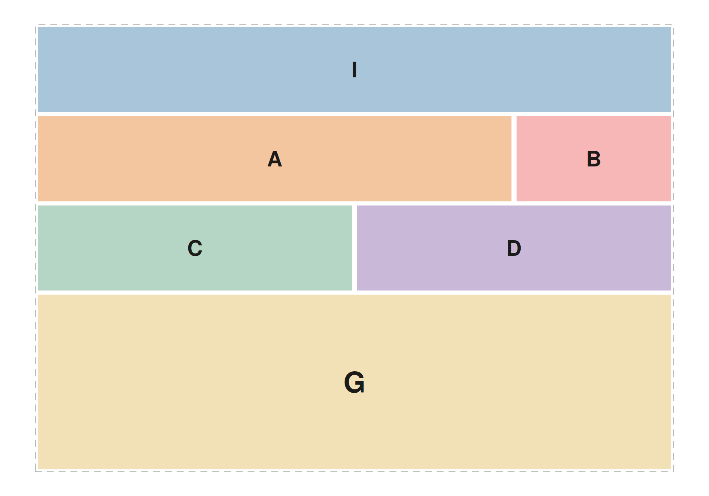

``` r

# per-track datasets
sig_xs <- seq(1.05e6, 2.95e6, length.out = 80)
sig_mu <- sin((sig_xs - 1e6) / 3e5) * 0.25 + 0.55
sig_gr <- GRanges("chr1", IRanges(sig_xs, width = 1),
                  mean = sig_mu,
                  lo   = sig_mu - 0.1,
                  hi   = sig_mu + 0.1)

density_gr <- GRanges("chr1",
  IRanges(start = seq(1e6, 3e6, length.out = 200), width = 1),
  score = c(rnorm(120, 0.3, 0.05),
            rnorm(80,  0.7, 0.08)))

mut_gr <- GRanges("chr1",
  IRanges(start = sample(seq(1.05e6, 2.95e6, by = 1e4), 18), width = 1),
  impact = runif(18, 0.2, 1.0))

seq_plot(layout = layout_str) %+%
  # I — ideogram strip
  seq_track(track_id = "I",
            windows = create_genome_windows("chr1:1000000-3000000")) %+%
    seq_ideogram(data = cb) %+%
  # A — signal ribbon
  seq_track(track_id = "A",
            data = sig_gr,
            mapping = map(x = start, y_min = lo, y_max = hi),
            windows = win) %+%
    seq_ribbon(aesthetics = aes(fill = "#4385BE", alpha = 0.5)) %+%
  # B — density sidebar
  seq_track(track_id = "B",
            data = density_gr,
            mapping = map(x = start, y = score),
            windows = win) %+%
    seq_density(aesthetics = aes(fill = "#879A39", alpha = 0.7)) %+%
  # C — bar summary
  seq_track(track_id = "C",
            data = bar_gr,
            mapping = map(x = start, y = score),
            windows = win) %+%
    seq_bar(aesthetics = aes(fill = "#8B7EC8")) %+%
  # D — lollipop mutation calls
  seq_track(track_id = "D",
            data = mut_gr,
            mapping = map(x = start, y = impact),
            windows = win) %+%
    seq_lollipop(aesthetics = aes(color = "#AF3029", linewidth = 1.2)) %+%
  # G — gene models spanning the full bottom row
  seq_track(track_id = "G",
            data = gene_gr,
            mapping = gm,
            windows = win) %+%
    seq_gene(gm) -> p
p$plot()
```

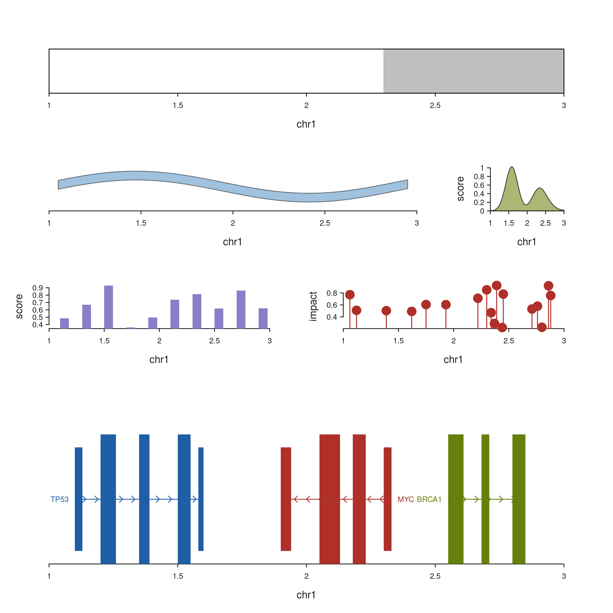

Cross-track connectors (`seq_string`, `seq_synteny`, `seq_zoom`) can be
added on top of a layout like this; see
[`vignette("links")`](http://andrewlynch.io/SeqPlotR/articles/links.md).
