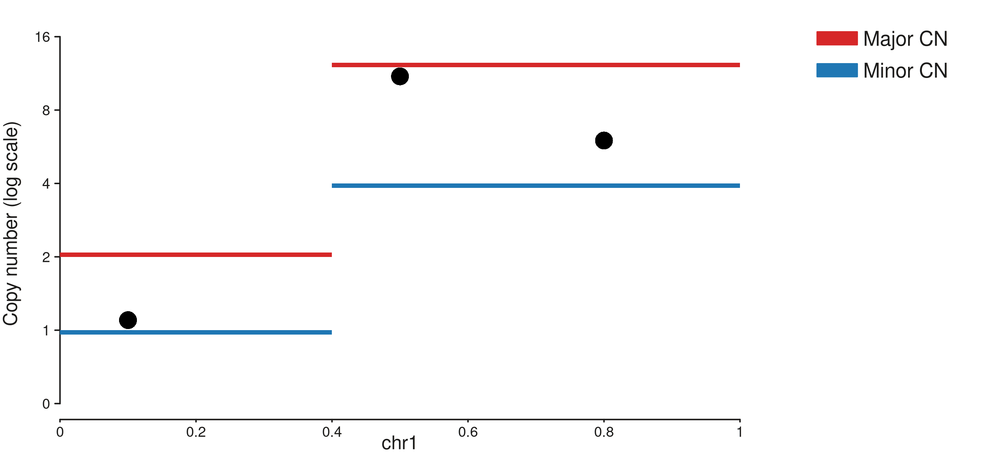
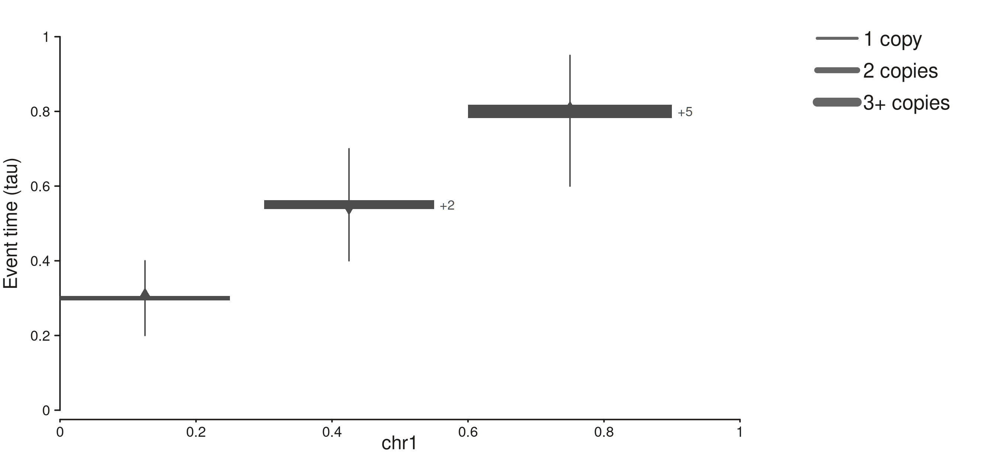
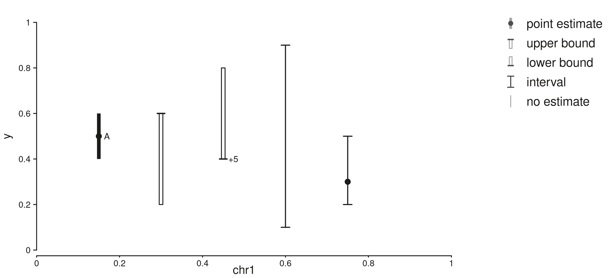
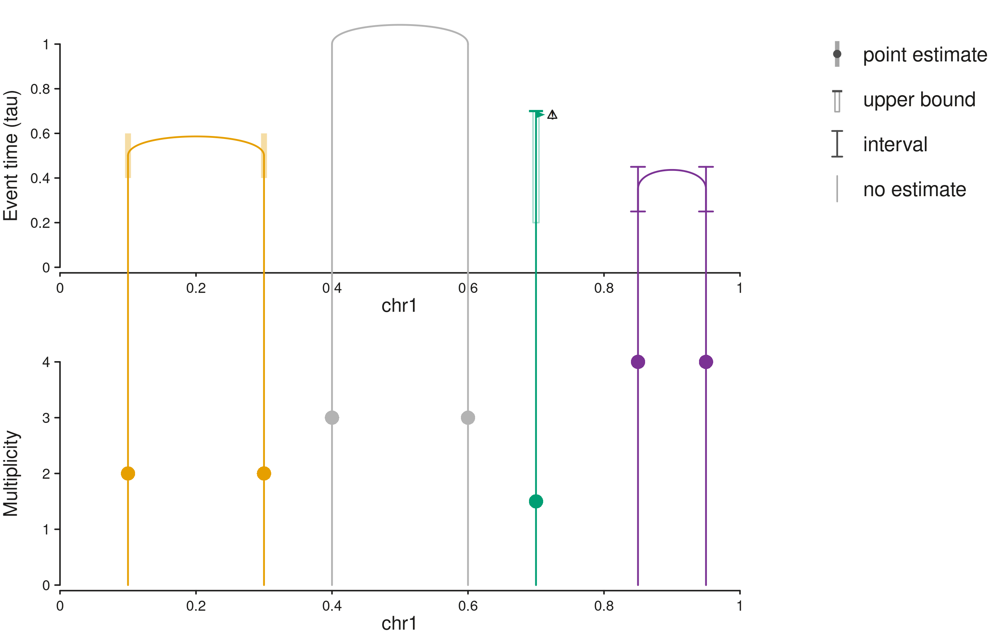
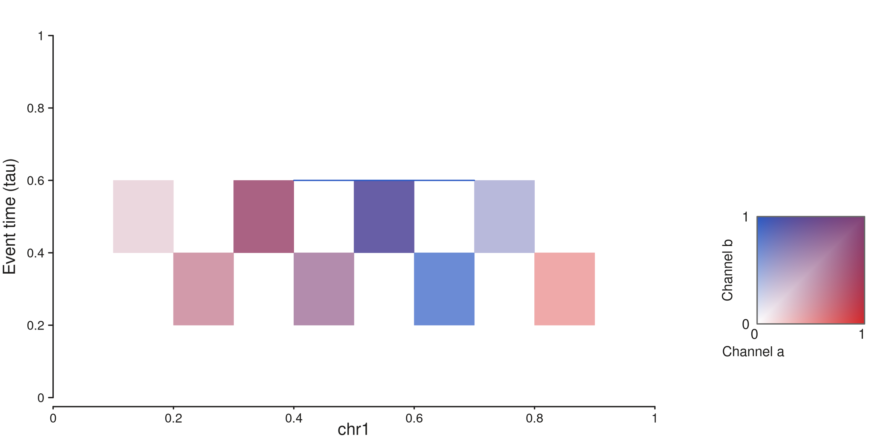
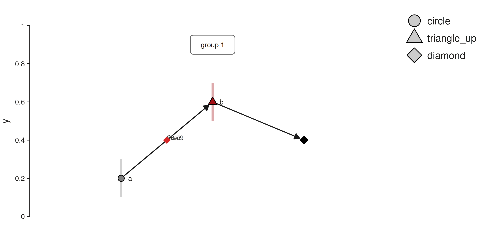
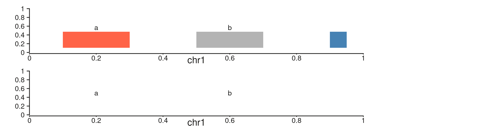

# Timing: Event-Time Elements and the ROSE Adapter

Event-timing plots stack several views of one genome: structural-variant
arches placed by event time, copy number with step ribbons, intervals
around estimated times, and a two-channel heatmap of timing density.
SeqPlotR provides generic elements for each view, and one adapter,
[`seq_rose_timing()`](http://andrewlynch.io/SeqPlotR/reference/seq_rose_timing.md),
that turns a table set written by ROSE into a plot built from those
elements.

Every element draws what it is given. ROSE (or any other caller)
supplies the positions, intervals, opacities, labels and colour
categories, and SeqPlotR does no timing computation. Rows that carry a
proxy bound are **order bounds, not times**: a bound says an event
happened before or after a point, and the plots mark it as such.

The first half of this article uses toy data to show each element. The
second half runs the adapter on the table sets shipped in
`inst/extdata/rose/timing`.

``` r

win <- GRanges("chr1", IRanges(1, 1e6))
page <- aes(margins = list(top = 0, right = 0.2, bottom = 0.02, left = 0))
```

## Count axis and paired ribbons

`seq_scale_count(max, log)` builds a copy-number axis with integer
ticks. With `log = TRUE` it uses a pseudo-log transform (values up to 1
stay linear, larger values are placed at `1 + log2(v)`) and labels the
ticks 0, 1, 2, 4, 8, 16. Every element on the track, including
`seq_point` and `seq_arch`, receives the transform, so values are given
in count units.

[`seq_paired_ribbon()`](http://andrewlynch.io/SeqPlotR/reference/seq_paired_ribbon.md)
draws two thin ribbons per span: `y_up` upward and `y_down` downward.

``` r

bands <- GRanges("chr1", IRanges(c(1, 4e5), c(4e5, 1e6)), major = c(2, 12), minor = c(1, 4))
snv <- GRanges("chr1", IRanges(c(1e5, 5e5, 8e5), width = 1), m = c(1.1, 11, 6))

seq_plot(aesthetics = page) %+%
  seq_track(
    track_id = "cn", windows = win,
    scale_y = seq_scale_count(12, log = TRUE),
    aesthetics = aes("axis.y.title.text" = "Copy number (log scale)"),
    elements = list(
      seq_paired_ribbon(bands, map(y_up = major, y_down = minor),
                        legend_labels = c(up = "Major CN", down = "Minor CN")),
      seq_point(snv, map(y = m))
    )
  ) -> p
p$plot()
```



## Step ribbons

[`seq_step_ribbon()`](http://andrewlynch.io/SeqPlotR/reference/seq_step_ribbon.md)
draws a span at height `y` whose thickness scales with `thickness`. A
vertical bar from `bar_lo` to `bar_hi` marks the interval, and a
triangle of fixed size in millimetres points up or down whatever the
span width. Labels are printed as given, so a label such as `+5` can sit
on a ribbon of thickness 3.

``` r

steps <- GRanges("chr1", IRanges(c(1, 3e5, 6e5), c(2.5e5, 5.5e5, 9e5)),
                 t = c(0.3, 0.55, 0.8), k = c(1, 2, 3), lab = c(NA, "+2", "+5"),
                 lo = c(0.2, 0.4, 0.6), hi = c(0.4, 0.7, 0.95),
                 dir = c("up", "down", "up"))

seq_plot(aesthetics = page) %+%
  seq_track(
    track_id = "steps", windows = win,
    scale_y = seq_scale_continuous(limits = c(0, 1)),
    aesthetics = aes("axis.y.title.text" = "Event time (tau)"),
    elements = list(
      seq_step_ribbon(steps, map(y = t, thickness = k, label = lab, bar_lo = lo,
                                 bar_hi = hi, pointing = dir),
                      legend_labels = c("1" = "1 copy", "2" = "2 copies", "3" = "3+ copies"))
    )
  ) -> p
p$plot()
```



## Interval glyphs

[`seq_interval_glyph()`](http://andrewlynch.io/SeqPlotR/reference/seq_interval_glyph.md)
marks an anchor with one of five glyphs: `point` (a point with a bar),
`latest` and `earliest` (a cap with an open bar, for one-sided bounds),
`interval` (a bracket, with a point only when `y` is given) and
`untimed` (nothing at the anchor). Rows with glyph `hidden` are dropped.
[`seq_glyph_legend_keys()`](http://andrewlynch.io/SeqPlotR/reference/seq_glyph_legend_keys.md)
builds matching legend keys.

``` r

g <- GRanges("chr1", IRanges(c(1, 2, 3, 4, 5) * 1.5e5, width = 1),
             y = c(0.5, 0.6, 0.4, NA, 0.3), lo = c(0.4, 0.2, 0.3, 0.1, 0.2),
             hi = c(0.6, 0.7, 0.8, 0.9, 0.5),
             kind = c("point", "latest", "earliest", "interval", "interval"),
             lab = c("A", NA, "+5", NA, NA))

seq_plot(aesthetics = page) %+%
  seq_track(
    track_id = "glyphs", windows = win,
    scale_y = seq_scale_continuous(limits = c(0, 1)),
    elements = list(
      seq_interval_glyph(g, map(y = y, bar_lo = lo, bar_hi = hi, glyph = kind, label = lab),
                         legend_all = TRUE)
    )
  ) -> p
p$plot()
```



## Cross-track arches

[`seq_cross_arch()`](http://andrewlynch.io/SeqPlotR/reference/seq_cross_arch.md)
is added to the track that holds the arch stems and names the track
whose axis places the arch tops with `target`. The two tracks must have
the same windows. The top is given in the target track’s units, so an
arch top lines up with a point or glyph drawn at the same value on the
target track. Optional fields draw interval bars on both stems (`glyph`,
`bar_lo`, `bar_hi`), a marker on each stem (`marker`) and a caution mark
(`caution`). A row without `x1` becomes a single stem, and a row with no
`top` reaches the top of the target axis. An anchor outside every window
stops with a message that names the row.

``` r

arch <- data.frame(
  chr = "chr1", pos1 = c(1e5, 4e5, 7e5, 8.5e5), pos2 = c(3e5, 6e5, NA, 9.5e5),
  top = c(0.5, NA, 0.7, 0.35), g = c("point", "untimed", "latest", "interval"),
  lo = c(0.4, NA, 0.2, 0.25), hi = c(0.6, NA, NA, 0.45), m = c(2, 3, 1.5, 4),
  col = c("#E69F00", "grey70", "#009E73", "#7B3294"), ca = c(FALSE, FALSE, TRUE, FALSE)
)

seq_plot(aesthetics = page) %+%
  seq_track(track_id = "sv", windows = win, direction = "under",
            scale_y = seq_scale_continuous(limits = c(0, 1)),
            aesthetics = aes("axis.y.title.text" = "Event time (tau)")) %+%
  seq_track(
    track_id = "cn", windows = win, direction = "under",
    scale_y = seq_scale_continuous(limits = c(0, 4)),
    aesthetics = aes("axis.y.title.text" = "Multiplicity"),
    elements = list(
      seq_cross_arch(arch, map(chrom0 = chr, x0 = pos1, chrom1 = chr, x1 = pos2, top = top,
                               glyph = g, bar_lo = lo, bar_hi = hi, marker = m,
                               color = col, caution = ca),
                     target = "sv", aesthetics = aes(bar_alpha = 0.35, glyph_points = FALSE),
                     legend_extra = c(unname(seq_glyph_legend_keys(c("point", "latest", "interval", "untimed")))))
    )
  ) -> p
p$plot()
```



## Two-channel heatmap

[`seq_tile_mix()`](http://andrewlynch.io/SeqPlotR/reference/seq_tile_mix.md)
colours each tile by mixing two intensities in `[0, 1]`: the hue moves
from `color_a` to `color_b` with the share of `b`, and the larger
intensity sets the depth. Tiles with both intensities zero are not
drawn. By default it adds a two-dimensional key from
[`seq_legend_2d()`](http://andrewlynch.io/SeqPlotR/reference/seq_legend_2d.md);
pass `legend = FALSE` to omit it. Bound lines compose from
[`seq_segment()`](http://andrewlynch.io/SeqPlotR/reference/seq_segment.md).

``` r

tiles <- GRanges("chr1", IRanges(seq(1, 9e5, by = 1e5), width = 1e5),
                 lo = rep(c(0.2, 0.4), length.out = 9), hi = rep(c(0.4, 0.6), length.out = 9),
                 a = c(0, 0.2, 0.5, 0.8, 0.6, 0.3, 0, 0.1, 0.4),
                 b = c(0, 0.1, 0.2, 0.5, 0.6, 0.9, 0.7, 0.4, 0))
bound <- GRanges("chr1", IRanges(4e5, 7e5), y = 0.6)

seq_plot(aesthetics = page) %+%
  seq_track(
    track_id = "heat", windows = win,
    scale_y = seq_scale_continuous(limits = c(0, 1)),
    aesthetics = aes("axis.y.title.text" = "Event time (tau)"),
    elements = list(
      seq_tile_mix(tiles, map(y_min = lo, y_max = hi, a = a, b = b),
                   aesthetics = aes(color_a = "#D62728", color_b = "#2B59C3"),
                   legend = seq_legend_2d("#D62728", "#2B59C3",
                                          x_title = "Channel a", y_title = "Channel b")),
      seq_segment(bound, map(x = start, x_end = end, y = y, y_end = y), aes(color = "#2B59C3"))
    )
  ) -> p
p$plot()
```



## Node-link panel

[`seq_node_link()`](http://andrewlynch.io/SeqPlotR/reference/seq_node_link.md)
draws nodes, edges and group boxes at the positions given. It runs no
layout algorithm. Nodes can carry an interval bar and one of five
shapes. Edges can carry an arrow, a label printed as given and a flag
marking a conflict.

``` r

nodes <- data.frame(id = c("A", "B", "C"), x = c(1, 2, 3), y = c(0.2, 0.6, 0.4),
                    bar_lo = c(0.1, 0.5, NA), bar_hi = c(0.3, 0.7, NA),
                    shape = c("circle", "triangle_up", "diamond"),
                    fill = c("#7F7F7F", "#A50F15", "black"), label = c("a", "b", NA))
edges <- data.frame(from = c("A", "A", "B"), to = c("B", "B", "C"),
                    arrow = c(TRUE, FALSE, TRUE), label = c("fixed", ">0.99", NA),
                    flag = c(FALSE, TRUE, FALSE), linetype = c(1, 2, 1))
groups <- data.frame(x = 2, y = 0.9, label = "group 1")

seq_plot(aesthetics = page) %+%
  seq_track(
    track_id = "nodes", windows = GRanges("events", IRanges(1, 1)),
    scale_x = seq_scale_continuous(limits = c(0.4, 3.6)),
    scale_y = seq_scale_continuous(limits = c(-0.03, 1.03)),
    aesthetics = aes("axis.x.visible" = FALSE),
    elements = list(seq_node_link(nodes = nodes, edges = edges, groups = groups))
  ) -> p
p$plot()
```



## Span strips

[`seq_span_strip()`](http://andrewlynch.io/SeqPlotR/reference/seq_span_strip.md)
labels spans with a coloured bar. With `bar_height = 0` only the labels
are drawn.

``` r

spans <- GRanges("chr1", IRanges(c(1e5, 5e5, 9e5), c(3e5, 7e5, 9.5e5)),
                 nm = c("a", "b", NA), col = c("tomato", NA, "steelblue"))

seq_plot(aesthetics = page) %+%
  seq_track(track_id = "bars", windows = win, scale_y = seq_scale_continuous(limits = c(0, 1)),
            elements = list(seq_span_strip(spans, map(label = nm, fill = col), aes(bar_y = 0.3)))) %+%
  seq_track(track_id = "text", windows = win, direction = "under",
            scale_y = seq_scale_continuous(limits = c(0, 1)),
            elements = list(seq_span_strip(spans, map(label = nm), aes(bar_height = 0)))) -> p
p$plot()
```



## Extending the elements

The base classes `SeqElementR6`, `SeqLinkR6`, `SeqArchR6` and
`SeqPointR6` are exported so that new elements can subclass them without
reaching into the package. `seq_to_canvas(x, y, panel)` maps a data
position through a panel, applying the track’s y transform, and is what
[`seq_cross_arch()`](http://andrewlynch.io/SeqPlotR/reference/seq_cross_arch.md)
uses to place tops on another track. A link’s `prep()` receives the
panels of all tracks in `layout_all_tracks`, named by `track_id`.

## The ROSE adapter

ROSE writes a `plot_timing` table set: windows, copy-number bands, SNV
points, SV arches, copy-number steps, glyphs, the heatmap and its
bounds, poset nodes, edges and groups, annotations and settings.
[`seq_read_table_set()`](http://andrewlynch.io/SeqPlotR/reference/seq_read_table_set.md)
reads it from a directory (or an in-memory list) and checks the schema
version; an unsupported version or a missing column stops with a message
that names the set, table and column.

``` r

tm <- system.file("extdata", "rose", "timing", package = "SeqPlotR")
list.files(tm)
#> [1] "example"          "sim_bfb_amplicon" "sim_simple_gain"  "sim_wgd_losses"
tb <- seq_read_table_set(file.path(tm, "sim_bfb_amplicon"), "plot_timing")
names(tb)
#>  [1] "windows"        "cn_bands"       "snv_points"     "sv_arches"     
#>  [5] "cn_steps"       "glyphs"         "heatmap"        "heatmap_bounds"
#>  [9] "poset_nodes"    "poset_edges"    "poset_groups"   "annotations"   
#> [13] "settings"
attr(tb, "schema_version")
#> [1] 1
```

`seq_rose_timing(x, layout, poset_view, ...)` accepts a directory or a
list and returns a `SeqPlot` built from the elements above. It only
selects rows, renames columns and looks up colours in a palette; every
position, interval, opacity and label comes from the tables.

| `layout` | Tracks |
|----|----|
| `"arches"` | SV event time with arches over copy number and step ribbons |
| `"order"` | arches placed at their poset layer |
| `"heatmap"` | arches over a two-channel timing heatmap |
| `"poset"` | node-link view (`poset_view` = `"poset"`, `"hasse"` or `"groups"`) |

Annotation and glyph labels get a strip above the genomic tracks, and an
ideogram (or, with `plain = TRUE`, a genomic axis) closes the plot. The
`palette` argument replaces any of the default colour sets by name, for
example `palette = list(sv = c(DEL = "black"))`.

### An amplicon with five SVs

The arches layout shows each SV at its estimated event time on the top
track. Bars are intervals reported by ROSE. The copy-number track shows
the major and minor copy number, SNV multiplicities and the arch ends,
and the bottom track shows copy-number gain and loss steps at their
event times, with `+2` marking a two-copy step.

``` r

bfb <- file.path(tm, "sim_bfb_amplicon")
p <- seq_rose_timing(bfb, layout = "arches")
p$plot()
```


The order layout places the same arches at their layer in the partial
order instead of at a time (layer 0 is unordered).

``` r

p <- seq_rose_timing(bfb, layout = "order")
p$plot()
```


The heatmap layout replaces the step ribbons with the timing density of
gains (red) and losses (blue).

``` r

p <- seq_rose_timing(bfb, layout = "heatmap")
p$plot()
```


The poset layout draws the events of the partial order at their time
estimates. An edge is labelled with the probability that the first event
precedes the second, or `fixed` for an order given as a constraint.

``` r

p <- seq_rose_timing(bfb, layout = "poset")
p$plot()
```


`poset_view = "hasse"` keeps only the reduction edges, and `"groups"`
draws the groups of events that cannot be separated.

``` r

p <- seq_rose_timing(bfb, layout = "poset", poset_view = "hasse")
p$plot()
```


### Whole-genome doubling and losses

This fixture has three windows and no SV arches. The WGD has no
position, so it is drawn as a black line across every window at its
time. Glyphs marked `earliest` and `latest` are proxy rows: they place
an event before or after a point, so they are drawn as one-sided bounds
rather than as times. SNVs above the axis maximum are excluded with a
message.

``` r

wgd <- file.path(tm, "sim_wgd_losses")
p <- seq_rose_timing(wgd, layout = "arches")
p$plot()
#> 3 out-of-bounds data points excluded! (seq_point)
```


``` r

p <- seq_rose_timing(wgd, layout = "heatmap")
p$plot()
#> 3 out-of-bounds data points excluded! (seq_point)
```


``` r

p <- seq_rose_timing(wgd, layout = "poset", poset_view = "groups")
p$plot()
```


### A single gain

``` r

gain <- file.path(tm, "sim_simple_gain")
p <- seq_rose_timing(gain, layout = "arches", plain = TRUE)
p$plot()
#> 6 out-of-bounds data points excluded! (seq_point)
```


The returned plot can be extended like any other. Here an extra track
with the same windows is added at the bottom.

``` r

wg <- seq_read_table_set(gain, "plot_timing")$windows
wg <- GRanges(wg$chr, IRanges(wg$start, wg$end))
p <- seq_rose_timing(gain, layout = "arches") %+%
  seq_track(track_id = "extra", windows = wg, direction = "under", track_height = 0.4)
p$plot()
#> 6 out-of-bounds data points excluded! (seq_point)
```


### An illustrative example set

`inst/extdata/rose/timing/example` is a small `plot_timing` table set
written by hand to show cases the simulated fixtures lack. It is an
illustrative example, not ROSE output and not a simulation: the numbers
were chosen to exercise the drawing rules and carry no biological
meaning. It has a copy-number maximum above 8 (log axis, `cn_log_axis`
TRUE), a single-breakend SV (SGL, no second anchor), an SV without
timing, a translocation, an ecDNA caution, a hidden glyph, annotation
rows, a whole-genome doubling, and conflict, unordered and exchangeable
poset edges.

``` r

ex <- file.path(tm, "example")
p <- seq_rose_timing(ex, layout = "arches", plain = TRUE, show_hidden = TRUE)
p$plot()
```


The log copy-number axis, the SGL arch (grey, one end) and the untimed
SV (drawn to the top of the axis without a bar) are on the first two
tracks. The WGD is the black line across all windows on the lower track,
and the strip at the very bottom lists the hidden glyph. In the order
layout the WGD is drawn at its poset layer.

``` r

p <- seq_rose_timing(ex, layout = "order", plain = TRUE)
p$plot()
```


``` r

p <- seq_rose_timing(ex, layout = "heatmap", plain = TRUE)
p$plot()
```


The poset shows the conflict marker, the dashed unordered and
exchangeable edges, and the WGD diamond.

``` r

p <- seq_rose_timing(ex, layout = "poset")
p$plot()
```


### Limits of the tables

The adapter uses only what the tables carry. There is no flag saying
whether the heatmap holds SNV-derived density, the copy-number axis
maximum is derived from the tables rather than stored, and annotation
colours are assigned from
[`flexoki_palette()`](http://andrewlynch.io/SeqPlotR/reference/flexoki_palette.md)
because the tables name classes without a palette. Rows without a
position (a WGD) are drawn across every window.
